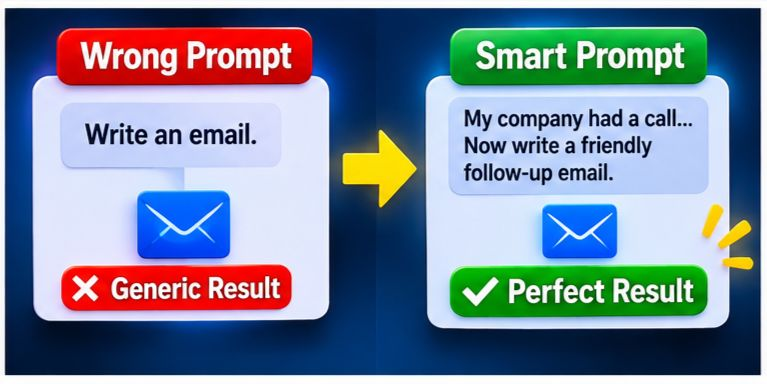

When using AI tools, most people fall into the trap of making four common mistakes that end up ruining their work. Instead of saving time, they waste hours trying to fix outputs that miss the mark. Those four mistakes are:

1. **Expecting AI to read your mind.** You give incomplete instructions, the AI fills in the blanks with guesses, and the result becomes useless.
2. **Trying to fix mistakes repeatedly in the same chat.** You keep repeating corrections, making the conversation unnecessarily long.
3. **Letting long chats degrade the output.** As the thread drags on, the AI gets confused, and the answers get worse instead of better.
4. **Burning through your free usage limit.** Sending dozens of back-and-forth messages drains your limit quickly—or forces the platform to quietly downgrade you to a weaker model.

On the surface, these look like four separate problems. In reality, they are all links in the exact same chain. Below is a clear breakdown of why these mistakes happen and the single solution that prevents all four at once.

## **1. Why AI Guesses Instead of Understanding You**

When asking AI to complete a task, most users type a vague, one-line request like, *"Write me an email."* While you have the full backstory in your head, the AI only knows what is written in your prompt. Everything else is a blank space—and AI is designed to fill blank spaces with assumptions.

If you want to understand how to structure instructions more effectively, our[ practical guide to prompt engineering](https://hostletprompt.online/articles/prompt-engineering-a-practical-guide-with-examples/) explains how to create clearer prompts with useful examples.

### **A Simple Example**

Suppose you need to follow up with a potential partner, and you tell the AI:

*"Write an email to a company."*

The AI has no idea:

* Why you are sending this email
* What your previous conversation with the company was about
* How they responded last time
* What outcome you want from this message

Because of that missing context, it writes a polite, generic template that could apply to any business on earth. The email isn't technically "wrong," but it isn't usable either.

### **Now Try the Right Approach**

Instead, give the AI the full picture upfront:

*"My company reached out to another business about a partnership. They replied saying they were busy and asked us to follow up in a month. Now I want to send a short, friendly follow-up email to politely remind them and let them know we are ready to talk."*

Now the AI knows the backstory, their previous reply, and your exact goal. The result is an email you can actually send.

**The Bottom Line:** AI cannot read your mind. Before giving any task, ask yourself three questions:

1. *Why am I doing this task?*
2. *What has happened so far?*
3. *What exact result do I want?*

Include all three answers in your very first prompt, and you will eliminate most revisions right away.

## **2. The Trap of Fixing Mistakes in the Same Chat**

When the first output misses the mark because of missing context, most people make their second mistake: they try to patch it up in the same thread using vague corrections like *"No, not like this,"* *"Make it better,"* or *"Still not right."*

### **What Happens Behind the Scenes?**

Every time you add a correction, the chat grows heavier. Soon, the AI is juggling its first draft, its second draft, your complaints, and your new instructions all at once. Eventually, it loses track of:

* What the original goal was
* Which instructions are outdated and which ones still apply
* What you actually want the final version to look like

Instead of improving, the output spirals downward.

### **How to Avoid the Revision Loop**

* **Give complete context upfront:** When you apply the three-question rule from the first section, the AI usually nails the task on the first try, keeping the chat short and focused.
* **Use numbered checkpoints for multi-step tasks:** For complex projects that naturally require back-and-forth, structure your updates in clear points:
* * *Point 1:* We have finalized the opening paragraph reminding the company of our last call.

  * *Point 2:* Now write the second paragraph proposing meeting times.

  * *Point 3:* The second section looks good. Now write a polite closing and thank-you note.

If the AI ever drifts off track, simply remind it: *"In Point 1 we did X, in Point 2 we did Y, and now we are working on Z."* This keeps a clear roadmap in front of the AI at all times.

For more ready-made instructions that can save time, explore our[ free AI prompt templates with examples for different AI platforms](https://hostletprompt.online/articles/prompt-templates-copy-paste-examples-a-simple-formula-and-mistakes-to-avoid-2026-guide/).

**The Bottom Line:** Repeating vague corrections only bloats your chat and confuses the AI. Give clear instructions upfront, and for longer workflows, guide the AI using structured checkpoints.

## **3. Why Long Chats Ruin AI Output Quality**

Many users assume that the longer they talk to an AI, the better it understands them. With current AI models, the exact opposite is often true.

### **The Problem with Context Overload**

Every time an AI generates a new response, it processes the conversation context available to it. As a chat drags on, it can accumulate rejected drafts, contradictory edits, half-finished thoughts, and shifting rules. In all that noise, the AI may struggle to separate active instructions from outdated ones—causing old mistakes to bleed into new answers.

### **A Simple Example**

At the start of a chat, you ask for a *"friendly"* email. Ten messages later, you say, *"Make it formal."* Five messages after that, you say, *"Make it shorter."* Now the AI is trying to follow changing instructions, potentially blending them into an awkward, robotic response. It feels like the AI suddenly "broke," when the real culprit may be conflicting instructions and accumulated context.

### **Warning Signs Your Chat Is Degrading**

* The AI repeats phrases or ideas you already told it to remove
* It forgets rules you set earlier in the conversation
* Its answers become noticeably shorter, vaguer, or more generic
* You find yourself repeating the same instructions over and over

### **How to Fix It**

1. **Start a fresh chat for every new task:** Never pile a brand-new topic onto the bottom of an old conversation.
2. **Summarize and reset:** If a chat gets too long, ask the AI: *"Write a brief summary of our progress so far, including my main goal, what is completed, and what is left to do."* Paste that summary into the first message of a brand-new chat. You keep all your progress while wiping away the clutter.

**The Bottom Line:** A longer chat does not automatically mean deeper understanding. The moment an AI starts drifting, summarize your progress and move to a clean slate.

## **4. How Free Usage Limits Quietly Affect Your AI Experience**

While the first three mistakes affect every AI user, this fourth issue hits free-tier users particularly hard—and very few people notice when it happens.

### **What Happens When You Hit the Limit?**

Many free AI platforms enforce usage caps over a rolling window of a few hours. Depending on the platform and its current policies, reaching a limit may mean waiting for a reset, losing access to certain features temporarily, or being switched to a different model.

The interface may look similar, but the model or features available to you can change. This can affect the quality and depth of the answers you receive.

### **Why This Creates a Vicious Cycle**

Because there may not always be an obvious warning, you assume *your prompt* is the problem. So you start sending more messages to fix the bad answers—which makes the chat longer, creates more opportunities for confusion, and uses up whatever message allowance you have left.

### **Signs Your AI Experience Has Changed**

* Answers suddenly become brief, generic, or overly reliant on basic bullet points
* Detailed reasoning disappears, replaced by surface-level replies
* Features such as file uploads or image generation become temporarily unavailable
* You see a notice mentioning usage limits or shorter responses

### **How to Protect Your Workflow**

1. **Check your message count before blaming your prompt:** If quality drops out of nowhere after a heavy session, check whether you have reached a usage limit.
2. **Pause and let the limit reset:** Free limits often refresh after a specified period. Taking a short break is more effective than repeatedly sending requests.
3. **Make every message count:** Packing full context into your first prompt drastically reduces the number of messages needed to finish a task.
4. **Save progress in checkpoints:** Keeping your work organized in numbered points lets you pause mid-project and resume seamlessly later—or pick up right where you left off on another AI platform.
5. **Be cautious with sensitive data:** Before pasting private personal or business details into any free AI tool, always check its privacy and data-training policies.

**The Bottom Line:** Sudden changes in AI quality on free plans may be caused by usage limits or model availability, not necessarily bad prompting. Save your progress in checkpoints so you never lose momentum when limits hit.

## **How One Well-Structured Prompt Solves All 4 Mistakes at Once**

These four issues aren't separate bugs—they are a chain reaction that can be triggered by one root cause: **unclear, incomplete prompting.**

High-level AI users avoid this entire trap by relying on structured, well-engineered prompts. A strong prompt delivers everything the AI needs in a clean, logical order—explaining the goal, the background, and the exact output format upfront. Because of that single prompt:

* **AI never has to guess**, because all essential context is already included.
* **You avoid endless revisions**, keeping your conversation short and focused.
* **The AI stays on track**, with fewer conflicting instructions cluttering the conversation.
* **You finish in fewer messages**, preserving your available usage limits.

For a practical example of organizing prompts for a specific AI platform, you can also read our guide on[ building and organizing a ChatGPT prompt library](https://hostletprompt.online/articles/chatgpt-prompt-library-how-to-build-and-organize-one/).

### **Stop Guessing and Start Using Proven Prompts**

Crafting a high-performing prompt from scratch takes time, testing, and careful structuring so the AI processes your instructions in the exact right sequence.

You don't have to do that heavy lifting yourself. On[ Hostlet Prompt](https://hostletprompt.online/), you get access to prompt resources tailored for top platforms, including:

* **[Best Claude AI Prompts](https://hostletprompt.online/best-prompts-for-claudeai):** Explore prompts designed for Claude AI tasks.
* **[Best ChatGPT Prompts](https://hostletprompt.online/best-prompts-for-chatgpt):** Find useful prompts for writing, research, productivity, and more.
* **[Best Gemini Prompts](https://hostletprompt.online/best-prompts-for-gemini):** Discover prompts tailored to Google's Gemini AI.
* **[Best Web Development Prompts](https://hostletprompt.online/best-prompts-for-webdevelpment):** Explore prompts for coding, debugging, and web development tasks.

You can also use the site's[ **free AI Prompt Generator**](https://hostletprompt.online/free-prompt-generator) to turn your rough ideas into a clean, structured prompt in seconds—helping you get accurate results in shorter chats without wasting your daily usage limits.

Getting better results from AI doesn't require complicated tricks; it simply requires clear, organized communication from the very first message. Whether you build your prompts manually or generate them using[ Hostlet Prompt](https://hostletprompt.online/), always ask yourself one question before hitting send:

**Have I given the AI my complete goal?**

To learn more about the website and its purpose, visit our[ About Us page](https://hostletprompt.online/about-us). If you have useful AI knowledge or original prompt ideas to share, you can also visit our[ Write for Us page](https://hostletprompt.online/write-for-us).
