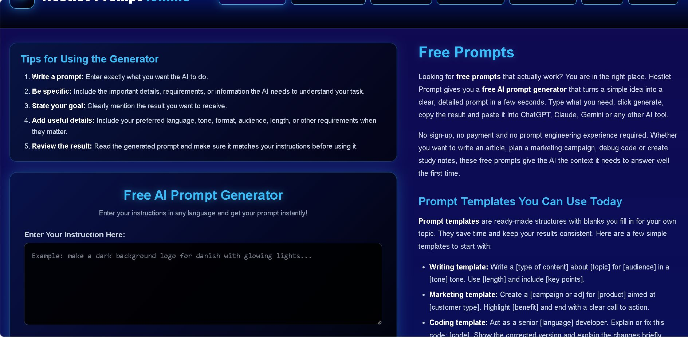
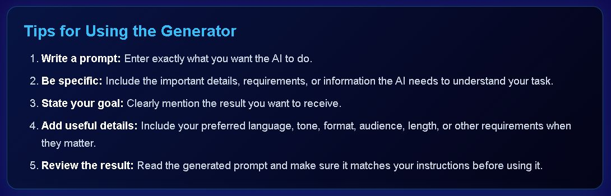
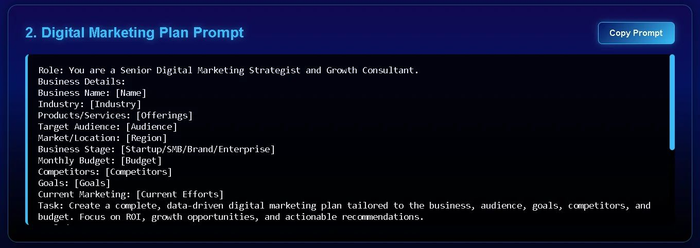

Artificial intelligence delivers strong results only when it receives clear instructions. Writing those instructions takes time, practice and skill. **Free prompts** remove that barrier by giving you proven, ready-to-use instructions at no cost.

This guide explains what free prompts are, how they work and why they can outperform paid prompt packs. It also introduces[ Hostlet Prompt](https://hostletprompt.online/), a platform built to provide reliable free prompts for professionals, students and developers. A complete prompt list is included at the end.

## **What Are Free Prompts and How Do They Work?**

A prompt is the instruction you give to an AI tool. It can ask the AI to draft an email, plan a trip or debug code.

**Free prompts** are ready-made instructions that anyone can copy and use at no cost. They are professionally structured and tested for clarity. You only need to add your own details.

The process is simple:

1. You find a prompt that matches your task.
2. You copy it.
3. You replace the blanks, like \[Topic] or \[Audience], with your own information.
4. You paste it into an AI tool such as ChatGPT, Claude or Gemini.
5. The AI gives you a detailed and useful answer.

An effective prompt contains a role, a task, context and a clear goal. Free prompts already include all four elements. This lets you skip the difficult drafting stage and get stronger results on the first attempt.

## **Why Free Prompts Are Better Than Paid Prompts**

Many websites sell prompt packs for $10, $20 or even $50. In most cases, you do not need to pay. Here is why free prompts are the smarter choice.

### **1. Free Prompts Save Your Money**

Paid prompt packs charge you for every purchase. Free prompts cost nothing and can be reused without limit. Your budget stays available for your business, tools or savings.

### **2. Paid Prompts Are Not Always Better**

A high price does not guarantee high quality. Many paid prompts are basic templates with premium branding. A well-built free prompt can deliver equal or better results.

### **3. You Can Test Before You Commit**

Free prompts let you test before you commit. If a prompt does not fit your needs, you simply move on. With paid prompts, you pay first and hope for the best.

### **4. No Sign-Up and No Hidden Costs**

Reputable free prompt sites do not ask for payment details or an email address. You open the page, copy the prompt and begin working.

## **Top Benefits of Using Free Prompts**

Free prompts offer more than cost savings. The key benefits are listed below.

* **Time savings.** You do not draft long instructions from scratch.
* **Higher-quality output.** Clear prompts produce clear, detailed responses.
* **Consistency.** The same template delivers the same standard every time.
* **Accessibility.** No prompt engineering knowledge is required.
* **Skill development.** You learn how expert prompts are structured and improve your own.
* **Wide coverage.** Writing, marketing, study, research and coding are all supported.
* **Tool flexibility.** One prompt works across ChatGPT, Claude, Gemini and other tools.
* **Fewer revisions.** You receive fewer vague or off-topic answers, so editing takes less time.

## **Hostlet Prompt: The Best Free Prompts Website**

Many websites offer prompts. Few are well organized, professionally written and truly free.[ Hostlet Prompt](https://hostletprompt.online/) was built for exactly this purpose. It serves writers, marketers, students, freelancers and developers.

The platform provides two core resources:

1. A **free AI prompt generator** that turns your simple idea into a detailed prompt.
2. **Ready-made prompt pages** for the most popular AI tools.

The points below explain why it stands out.

### **Why Hostlet Prompt Is Best for Free Prompts**

* **Completely free.** There is no payment and no sign-up.
* **Free prompt generator.** The[ free prompt generator](https://hostletprompt.online/free-prompt-generator) turns a simple idea into a detailed prompt in seconds.
* **Organized pages.** Each AI tool has a dedicated page, so you find the right prompt quickly.
* **Professional structure.** Every prompt includes a role, input details, a task and requirements.
* **One-click copying.** Each prompt has a "Copy Prompt" button.
* **Multilingual input.** You can write your instruction in any language.
* **Suitable for all levels.** Beginners and experienced users both benefit.

To explore the platform, visit the[ Hostlet Prompt home page](https://hostletprompt.online/). To learn about the team, read the[ About Us page](https://hostletprompt.online/about-us). If you are a writer and wish to contribute, see the[ Write for Us page](https://hostletprompt.online/write-for-us).

## **The Free Prompt Generator: Create Prompts for Free**

The[ free AI prompt generator](https://hostletprompt.online/free-prompt-generator) is the core tool of the platform. It is simple to use.

You enter a short idea, such as "make a dark-background logo for a bakery with glowing lights." The generator converts it into a clear, detailed prompt. You then copy the result and paste it into your AI tool.

There is no sign-up and no payment. You can use it as often as you need.

## In short, the generator lets you build custom, paid-quality prompts at no cost.\

**How to Use the Free Prompt Generator Step by Step**

The[ free prompt generator](https://hostletprompt.online/free-prompt-generator) is easy to use. You can turn a basic idea into a strong, professional-grade prompt. Follow these steps.

1. **Open the generator.** Go to the free AI prompt generator page.
2. **Type your instruction.** Write what you want the AI to do in the text box.
3. **Click generate.** The tool builds a clear and detailed prompt.
4. **Copy the result.** Take the full prompt.
5. **Paste it into your AI tool.** Use it in ChatGPT, Claude, Gemini or any other tool.\
   **Tips for Best Results**

   ## **Your result depends on the quality of your instruction. Apply these tips from the generator page.**

   * **Write a prompt.** Enter exactly what you want the AI to do.
   * **Be specific.** Include the key details, requirements and information the AI needs.
   * **State your goal.** Say clearly what result you expect.
   * **Add useful details.** Include your preferred language, tone, format, audience and length.
   * **Review the result.** Read the generated prompt and confirm it matches your intent before using it.

   ### **A Weak Instruction vs. a Strong Instruction**

   Compare the two instructions below.

   **Weak:** "Write about coffee."

   **Strong:** "Write a 600-word blog post about the health benefits of coffee for office workers. Use a friendly tone. Add five short tips and end with a call to action."

   The second instruction specifies the topic, length, audience, tone and structure. The generator can then build an even stronger prompt from it.

## **Best Free Prompts for Each AI Tool**

Each AI tool has different strengths. For this reason, Hostlet Prompt gives every tool its own page with 10 specialized prompts.

### **Best Prompts for Claude AI**

Claude is known for clear, natural and well-structured writing. It is a strong choice for emails, posts, captions and scripts.

The[ best prompts for Claude AI](https://hostletprompt.online/best-prompts-for-claudeai) page focuses on writing tasks. It includes prompts for:

* Professional emails
* Cold outreach emails
* Follow-up emails after meetings
* Social media content calendars
* SEO blog writing
* Product descriptions
* LinkedIn posts
* Instagram captions
* Apology emails
* YouTube video scripts

**Why Claude for these tasks?** Claude writes in a calm, human tone. It keeps long text well organized and follows detailed instructions closely. This makes it ideal for work where tone matters.

### **Best Prompts for ChatGPT**

ChatGPT is a versatile tool that performs well in strategy, planning, analysis and sales content.

The[ best prompts for ChatGPT](https://hostletprompt.online/best-prompts-for-chatgpt) page focuses on business and marketing. It includes prompts for:

* A complete SEO strategy
* A digital marketing plan
* High-converting sales copy
* Job interview preparation
* Blog post ideas
* Email marketing campaigns
* Business data analysis
* Business marketing strategy
* Explaining any topic simply
* Viral YouTube video ideas

**Why ChatGPT for these tasks?** ChatGPT excels at step-by-step plans and structured answers. It can turn a detailed business brief into a complete strategy, which makes it well suited to marketing and sales.

### **Best Prompts for Gemini**

Gemini is strong in research, comparison and working with current information. It can also analyze images.

The[ best prompts for Gemini](https://hostletprompt.online/best-prompts-for-gemini) page covers research and everyday planning. It includes prompts for:

* Research reports
* Comparing products
* Study plans
* Explaining any topic
* Latest news summaries
* Travel itinerary planning
* Resumes and cover letters
* Image analysis
* Language learning
* Meal and workout plans

**Why Gemini for these tasks?** Gemini works well with fresh information and large data sets. It can read images and compare facts, which makes it a strong choice for research, learning and planning.

### **Best Prompts for Web Development**

AI can now write and fix code, but it needs precise instructions. A weak prompt produces weak code.

The[ best prompts for web development](https://hostletprompt.online/best-prompts-for-webdevelpment) page includes prompts for:

* HTML and CSS website development
* Converting a design into responsive HTML and CSS
* E-commerce websites
* Portfolio websites
* Fixing JavaScript errors
* SaaS dashboards
* AI mobile apps
* Website speed optimization
* Blog websites
* SEO meta tags and schema markup

This page is covered in more detail later in this article.

## **How to Turn Free Prompts into Paid-Quality Prompts**

Many people believe a prompt must be expensive to be effective. This is not true. You can upgrade any free prompt in three steps.

1. **Add your own details.** The more facts you give, the better the answer.
2. **Set the tone and format.** Ask for a table, a list, a short email or a long guide.
3. **Give a clear goal.** Tell the AI what success looks like.

The generator supports all three steps. As a result, a free prompt can match the strength of a paid one.

### **How to Fill  a Prompt for the Best Result**

Let us use the **Digital Marketing Plan Prompt** from the ChatGPT page. It looks like this:

Role: You are a Senior Digital Marketing Strategist and Growth Consultant. Business Details: Business Name: \[Name] Industry: \[Industry] Products/Services: \[Offerings] Target Audience: \[Audience] Market/Location: \[Region] Business Stage: \[Startup/SMB/Brand/Enterprise] Monthly Budget: \[Budget] Competitors: \[Competitors] Goals: \[Goals] Current Marketing: \[Current Efforts] Task: Create a complete, data-driven digital marketing plan tailored to the business, audience, goals, competitors, and budget. Focus on ROI, growth opportunities, and actionable recommendations.

## **Follow these steps to get the best result.**

1. **Click "Copy Prompt."** Copy the full text.
2. **Replace each bracket.** Change every \[bracket] into your real information.
3. **Be exact.** Write "Bakery," not "food." Write "$500 per month," not "small budget."
4. **Keep the role line.** The role tells the AI how to think and write.
5. **Do not delete the task.** The task tells the AI what to produce.
6. **Paste and send.** Add the prompt to your AI tool.
7. **Improve the answer.** If you need more, ask a follow-up question.

### **Example 1: A Filled-In Marketing Prompt**

Here is the same prompt after you add real information.

Role: You are a Senior Digital Marketing Strategist and Growth Consultant. Business Details: Business Name: Sweet Crumbs Bakery Industry: Food and Bakery Products/Services: Custom cakes, cupcakes, and party boxes Target Audience: Women aged 22–40 who plan birthdays and small events Market/Location: Lahore, Pakistan Business Stage: Startup Monthly Budget: $300 Competitors: Two local cake shops and a home-based baker on Instagram Goals: Get 50 new orders per month in six months Current Marketing: A basic Instagram page with 800 followers Task: Create a complete, data-driven digital marketing plan tailored to the business, audience, goals, competitors, and budget. Focus on ROI, growth opportunities, and actionable recommendations.

With these details, the AI produces a plan tailored to this bakery. Without them, it produces a generic plan that fits no one.

### **Example 2: A Filled-In Sales Copy Prompt**

The ChatGPT page also has a **High-Converting Sales Copy Prompt**. It starts like this:

Role: You are an expert Direct Response Copywriter, Conversion Strategist, and Consumer Psychology Specialist. Input: Product/Service: \[Product] Industry: \[Industry] Target Audience: \[Audience] Offer: \[Offer details] USP: \[Unique Selling Proposition]

After you fill it in, it can look like this:

Product/Service: Online Urdu typing course Industry: Education Target Audience: University students who want a part-time skill Offer: 30-day course with a 7-day money-back guarantee USP: Lessons are short, live, and taught in simple Urdu

Now the AI knows who it is writing for and what makes your offer different. The resulting sales copy will be far sharper.

**Tip:** USP means Unique Selling Proposition. It is the reason people should choose you over others. Always write it clearly.

## **Why Each Page Has Its Own AI Model**

You may ask why the prompts are split across four pages. The reason is simple: each AI tool is better at certain jobs. The prompts on each page are matched to the strengths of that tool.

Each prompt heading tells you what the prompt is for, so you can choose the right page quickly. The sections below explain why each tool fits its page.

### **Why Gemini Is Great for Research**

Gemini is built to work with large amounts of information. It can compare facts, read images and summarize the latest news. That is why the Gemini page includes research reports, product comparisons, news summaries and image analysis. These tasks demand accuracy and current data, and Gemini is a strong fit.

### **Why Claude AI Is Great for Writing**

Claude writes in a smooth, natural voice and keeps its tone steady across long text. The Claude page therefore includes prompts for emails, captions, LinkedIn posts, scripts and blog articles. In these tasks, the quality of the wording matters most.

### **Why ChatGPT Is Great for Strategy and Business**

ChatGPT handles long, step-by-step tasks well. It can build plans, analyze data and write sales copy from a list of details. That is why the ChatGPT page features SEO strategy, marketing plan, sales copy and interview preparation prompts.

### **Why Web Development Has Its Own Page**

Coding prompts need a different style. They require exact technical details such as language, layout and features. For this reason, they are kept on a separate page.

You can still try any prompt in any tool. The pages are a guide, not a rule. However, the matched tool often gives the best result.

## **How Web Development Prompts Can Turn a Beginner into an Experienced Designer**

The web development page is one of the most valuable parts of the platform. Beginners often do not know what to ask the AI. Experts know how to describe a website in detail. These prompts close that gap.

Each prompt teaches you to think like a professional designer. You learn which details to include: layout, colors, fonts, sections, mobile view and speed. Over time, you begin to write these details yourself. That is how a simple designer grows into an experienced one.

Here is what the[ web development prompts page](https://hostletprompt.online/best-prompts-for-webdevelpment) offers.

### **Build a Website from Scratch**

The **HTML CSS Website Development** prompt helps you plan and build a complete site. The AI returns clean code and a clear structure, which makes it ideal for first-time builders.

### **Turn a Design into Code**

The **Convert Design into Responsive HTML CSS** prompt is made for people who have a design but no code. You describe the design or share an image. The AI turns it into a page that works on phones, tablets and desktops.

### **Create Pages with Images**

You can also build a main page together with images. Tell the AI which pictures you need and where they belong. It builds the layout around them. This helps you create a complete, polished home page quickly.

### **Debug and Fix Errors**

The **Fix JavaScript Errors** prompt works as a debugging assistant. You paste your broken code and describe the problem. The AI locates the error, fixes it and explains the change. This saves hours and shows you why the code failed.

### **Build Ready-Made Website Types**

Prompts are available for e-commerce stores, portfolios, blogs and SaaS dashboards. Each one lists the pages and features that type of site requires, so you do not have to guess.

### **Improve Speed and SEO**

Two prompts focus on performance. The **Website Speed Optimization** prompt helps your site load faster. The **SEO Meta Tags and Schema Markup** prompt helps search engines understand your pages. Both support better rankings.

### **Build Apps with AI**

The **AI Mobile App Development** prompt helps you plan an app. It covers features, screens and structure, giving you a clear starting point.

Repeated use of these prompts builds real skill. You see how professionals write instructions. Soon you can build, fix and improve websites with confidence.

## **Complete List of Free Prompts on Hostlet Prompt**

The full list of prompts is below. Select a page name to open it.

### **Claude AI Page:[ Best Prompts for Claude AI](https://hostletprompt.online/best-prompts-for-claudeai)**

1. AI Prompt for Writing Professional Emails
2. AI Prompt for Cold Outreach Emails
3. AI Prompt for Follow-Up Emails After Meetings
4. AI Prompt for Social Media Content Calendar
5. AI Prompt for SEO Blog Writing
6. AI Prompt for High-Converting Product Descriptions
7. AI Prompt for LinkedIn Posts
8. AI Prompt for Viral Instagram Captions
9. AI Prompt for Professional Apology Emails
10. AI Prompt for YouTube Video Scripts

### **ChatGPT Page:[ Best Prompts for ChatGPT](https://hostletprompt.online/best-prompts-for-chatgpt)**

1. ChatGPT Prompt for Complete SEO Strategy
2. ChatGPT Prompt for Digital Marketing Plan
3. ChatGPT Prompt for High-Converting Sales Copy
4. ChatGPT Prompt for Job Interview Preparation
5. ChatGPT Prompt for Blog Post Ideas
6. ChatGPT Prompt for Email Marketing Campaigns
7. ChatGPT Prompt for Business Data Analysis
8. ChatGPT Prompt for Business Marketing Strategy
9. ChatGPT Prompt to Explain Any Topic Simply
10. ChatGPT Prompt for Viral YouTube Video Ideas

### **Gemini Page:[ Best Prompts for Gemini](https://hostletprompt.online/best-prompts-for-gemini)**

1. Gemini Prompt for Research Reports
2. Gemini Prompt to Compare Products
3. Gemini Prompt for Study Plans
4. Gemini Prompt to Explain Any Topic
5. Gemini Prompt for Latest News Summaries
6. Gemini Prompt for Travel Itinerary Planning
7. Gemini Prompt for Resume and Cover Letter
8. Gemini Prompt for Image Analysis
9. Gemini Prompt for Language Learning
10. Gemini Prompt for Meal and Workout Plans

### **Web Development Page:[ Best Prompts for Web Development](https://hostletprompt.online/best-prompts-for-webdevelpment)**

1. AI Prompt for HTML CSS Website Development
2. AI Prompt to Convert Design into Responsive HTML CSS
3. AI Prompt for E-Commerce Website Development
4. AI Prompt for Portfolio Website Design
5. AI Prompt to Fix JavaScript Errors
6. AI Prompt for SaaS Dashboard Development
7. AI Prompt for AI Mobile App Development
8. AI Prompt for Website Speed Optimization
9. AI Prompt for Blog Website Development
10. AI Prompt for SEO Meta Tags and Schema Markup

## **Tips to Get the Most from Free Prompts**

* **Fill every blank.** Empty brackets lead to weak answers.
* **Use real numbers.** Budgets, dates and sizes help the AI plan better.
* **Ask follow-up questions.** If the first answer is not perfect, ask the AI to refine it.
* **Test the same prompt in two tools.** You may prefer one result.
* **Verify the facts.** AI can make mistakes, so review important details.
* **Save your best prompts.** Keep a list of those that work well for you.

## **Frequently Asked Questions**

### **Are free prompts really free?**

Yes. On[ Hostlet Prompt](https://hostletprompt.online/), all prompts and the generator are free. You do not need to sign up or pay.

### **Can I use free prompts in any AI tool?**

Yes. You can paste them into ChatGPT, Claude, Gemini or any other AI tool. The prompts are made with clear instructions, so they work in most tools.

### **Do I need prompt engineering skills?**

No. The prompts are ready-made. You only fill in your own details.

### **Can I create my own prompt?**

Yes. Use the[ free prompt generator](https://hostletprompt.online/free-prompt-generator). Type your idea and get a detailed prompt in seconds.

### **Can I share my own prompts on the site?**

Yes. Visit the[ Write for Us page](https://hostletprompt.online/write-for-us) to learn how.

## **Conclusion**

**Free prompts** save you money, time and effort. They provide clear structure, so AI tools deliver better answers. You do not need to buy expensive prompt packs.

[Hostlet Prompt](https://hostletprompt.online/) is a strong place to start. It offers a free prompt generator and organized pages for every popular AI tool. Explore the best prompts for[ Claude AI](https://hostletprompt.online/best-prompts-for-claudeai),[ ChatGPT](https://hostletprompt.online/best-prompts-for-chatgpt),[ Gemini](https://hostletprompt.online/best-prompts-for-gemini) and[ web development](https://hostletprompt.online/best-prompts-for-webdevelpment).

Choose a prompt, fill in your details and paste it into your preferred AI tool. The improvement is immediate. Start using free prompts today and get more from every AI tool you use.
