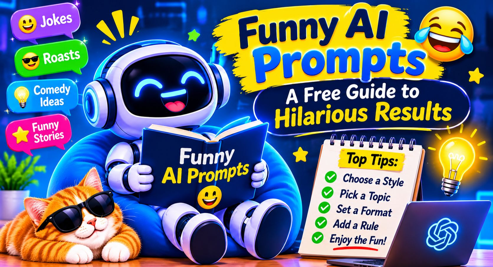

*Funny AI prompts sort of work best when you give the AI a specific style, a clear target , and like a few rules it has to follow. Don’t just type “tell me a joke” right. Instead you describe the comedian’s vibe, the topic, and the format. That little switch can take bland answers, and boom, they actually make you laugh.*

*This guide walks you through why most jokes from AI flop, how to write prompts that hit harder , and it gives you copy paste examples you can try basically today.*

## ***Why Funny AI Prompts Often Fall Flat***

*When you ask an AI for “something funny,” you’ll get the safest, most boring pun. That’s because it doesn’t really know what kind of funny you mean. Dry humor, silly humor, sarcastic humor, and dark humor are not the same thing at all.*

*Also the AI plays it safe by default. It tends to grab the most common joke structure, and then… everything feels like it came from some greeting card.*

*So the fix is kinda straightforward. Give it more material. Let’s see how.*

## \
***How to Write Funny AI Prompts That Work***

*Funny usually comes from details that are too specific to ignore. Use this simple formula, or steal it:*

*1. Choose a style. Say “deadpan,” “over-the-top dramatic,” or “like a grumpy pirate.”*

*2. Choose a topic. More specific is better. “Monday meetings” beats “work.”*

*3. Set the format. One-liner, short story, poem, text chat, or even a product review type thing.*

*4. Add a rule. Like “no puns” or “under 50 words.”*

*5. Say who it’s for. Coworkers, kids, or close friends all need different comedic pacing.*

*Here’s a prompt that shows the formula in action.*

### ***Example Prompt***

*Write a deadpan, sarcastic product review of a coffee mug that "changed my life" but only because it keeps my coffee warm for exactly 4 minutes. Keep it under 80 words and don't use any puns.*

*Tip: Swap the mug for any everyday item, like a printer, a charger, or a pair of socks.*

*If you don’t want to build prompts from scratch every single time, there are* [free prompt generator](https://hostletprompt.online/free-prompt-generator) *that can help you fill in the pieces fast.*

*Now you know the formula, so let’s test it on a popular tool.*

## *Funny ChatGPT Prompts You Can Copy*

*ChatGPT is good at character stuff, so comedy kind of naturally fits. The secret is giving it a persona, not just a request. If you want laughs but also other tones, you can check these best [prompts for ChatGPT.](https://hostletprompt.online/best-prompts-for-chatgpt)*

*Try asking it to explain boring things in a ridiculous voice. Like taxes explained by a dramatic soap opera narrator, yep that’s a good example.*

### ***Example Prompt***

*Act as an overly dramatic soap opera narrator. Explain how to boil an egg in 6 steps. Every step should end with a shocking cliffhanger. Keep the tone serious and the situation absurd.*

*Tip: If the first answer feels too mild, reply with “make it 2x more dramatic” and it should escalate.*

*Those are character based laughs. But sometimes you just want something quick, like a one breath joke.*

## ***AI Joke Prompts for Quick Laughs***

*For fast jokes, limits are your best friend. If you tell the AI what to include exactly , the results tend to be sharper and less predictable.*

## ***A few methods that help:***

*\* Name two unrelated things and ask it to connect them.*

*\* Ask for a joke with a surprise ending.*

*\* Request a “bad joke” on purpose, because “bad” often turns into funny, somehow…*

*\* Ask for 10 options, then pick the best and ask for more in that same lane.*

### ***Example Prompt***

*Give me 10 original one-liner jokes about working from home. Each joke must include a pet or a houseplant. Avoid common jokes about pajamas.*

*Tip: Ask the AI to score its own jokes from 1 to 10, then rewrite the three weakest ones.*

*Jokes are great, but roasts are where a lot of people want to jump next.*

*AI Roast Prompts That Stay Friendly*

*Roasts can be hilarious, but they need guardrails. The goal is playful teasing, not mean insults. Tell the AI to keep it lighthearted, and base it on harmless habits, not on looks, family, health , or personal struggles.*

### ***Example Prompt***

*Write a friendly roast of my friend Sam, who is always 20 minutes late, loves spreadsheets, and thinks he's great at barbecue. Keep it lighthearted, avoid anything about looks or family, and end with a compliment.*

*Tip: Only roast people who’d laugh along, and share the result with them first if you’re not sure.*

*Funny AI Prompts for Friends and Group Chats*

*Humor lands better when it’s personal. Funny AI prompts for friends work well when you include inside jokes, shared habits, or some ongoing running gag. The AI can’t know that stuff by magic, so you have to feed it in.*

## ***A few ideas:***

*\* A fake movie trailer starring your friend group*

*\* A “weather forecast” for your friend’s chaotic week*

*\* A dramatic breakup letter to the last slice of pizza*

*\* A fake award show speech for “Most Likely to Reply Three Days Later”*

### ***Example Prompt***

*Write a 100-word fake movie trailer for a film about four roommates fighting over one bathroom. Use a deep trailer voice, add a title, a tagline, and a fake review quote at the end.*

*Tip: Toss in real details like names and quirks so it feels like it was written just for your group.*

*AI Comedy Writing: Taking Your Humor Further*

*Once you’re comfy with short prompts, you can stretch into longer stuff, like sketches, stand-up bits, or silly little short stories. Different tools sometimes handle the same prompt a bit differently, so test it in more than one place. If you want to compare styles, look up ideas for[ Claude AI prompts](https://hostletprompt.online/best-prompts-for-claudeai) and[ Gemini prompts.](https://hostletprompt.online/best-prompts-for-gemini)*

## ***For longer comedy, do it in rounds:***

*1. Ask for a rough draft.*

*2. Tell the AI what is not funny, and why.*

*3. Ask it to rewrite with a stronger ending, like genuinely stronger.*

### ***Example Prompt***

*Write a 2-minute stand-up bit about trying to cancel a gym membership. Make it conversational, and add three escalating “twists”  (like the situation gets worse, but in a funny way). End it with a callback to the first line. Also, quick tip, try reading it out loud , it will show fast which lines stick and which need another pass.* 

## ***Common mistakes to avoid***

*Yeah even a really good prompt can go off the rails. So watch for:*

*\* Being kinda vague, like “be funny” and then… nothing to aim at.*  

*\* Asking for too much at once, one joke format per prompt, works better.*  

*\* Skipping the follow-up, the second and third tries usually, get you the best stuff.*  

*\* Crossing the line, keep it light, dont target groups, or anything sensitive, you know.*  

*\* Expecting perfect results, AI humor is more like a starting point, a quick human edit makes it better.*  

## ***FAQ***

***What are the best funny AI prompts for beginners?***

*Start with prompts that have a character, like “explain something simple” in a pirate voice or a dramatic narrator voice. They’re easy to write, and they give more predictable results, most of the time.*  

***Why is AI humor sometimes not funny?***

*Because it tends to play it safe, so you get common joke patterns that feel… familiar. When you add a style, a specific topic, and a few rules, it usually avoids the generic stuff.*  

***Can I use funny AI prompts with any chatbot?***

*Yes, you can use similar prompts in ChatGPT, Claude, Gemini, and most other chatbots. The answers change a bit though, so try your prompt in more than one place.*  

***Is it ok to use AI-generated jokes in public?***

*For casual use like social posts or group chats, it’s usually fine. Just make sure you didn’t copy someone else, and keep it kind and appropriate for who’s reading or listening.*  

### ***Final thoughts***

*Funny AI prompts basically come down to three things. A clear style, a specific topic, and a few simple rules. Start with one prompt from this guide, tweak it for your people or your real life, and keep refining until it actually makes you laugh. And for your next step, pick one example above, run it today, and tell the AI to make it funnier once, then come back and repeat it.*
