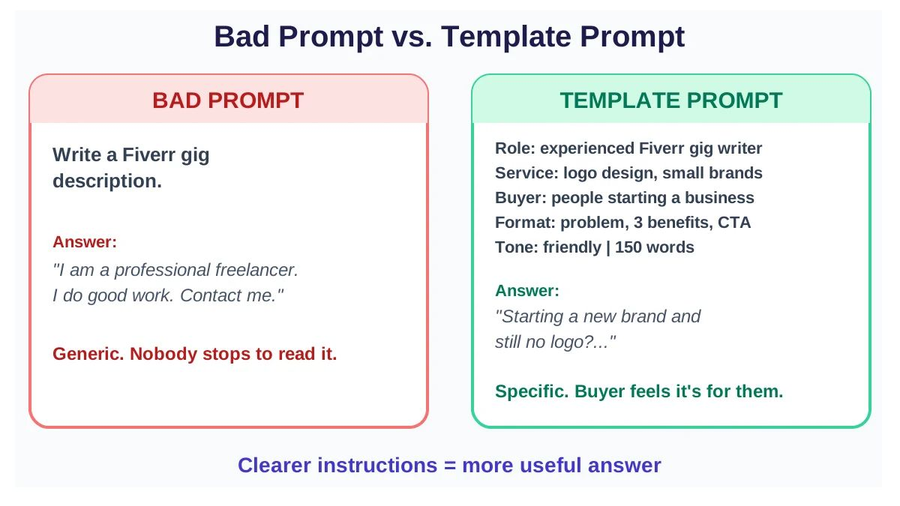
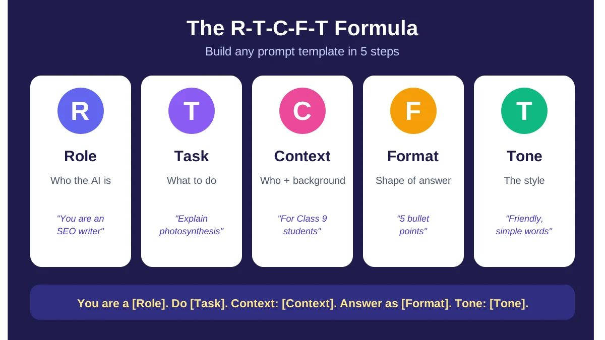
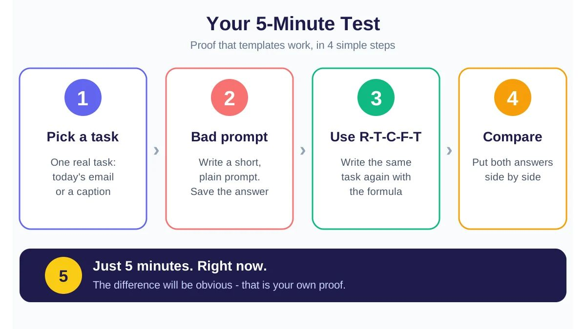

**SEO details (copy before publishing)**

* **Meta title:**

   Prompt Templates: Free Copy-Paste Examples + Simple Formula (2026)
* **Meta description:**

   Learn prompt templates the easy way: copy-paste examples for blogging, freelancing, YouTube and study, a 5-point formula, common mistakes and a free cheat sheet.
* **URL slug:**

   prompt-templates-guide
* **Focus keyword:**

   prompt templates

Have you ever asked an AI tool for help and got an answer that was too vague to use? Most of the time the tool is fine. The question is the problem. **Prompt templates** fix that. They are ready-made question formats that you fill in and reuse, so you get a clear, useful answer every time. This guide explains them in plain language and gives you templates you can copy today. No coding and no technical words.

## What Are Prompt Templates?

Think about cooking the same dish every week. You do not invent the recipe each time. You follow a recipe card, and the dish tastes the same every time.

**A prompt template is a recipe card for AI.** It is a ready structure with a few blank spaces. You fill in the blanks with your own details, and the AI gets clear instructions.

**Prompt vs. prompt template:**

Prompt

Prompt template

Meaning

A one-time question

A structure you reuse again and again

Example

“Write a blog post.”

“You are a \[role]. Write a \[tone] blog post about \[topic]…”

Best for

A single task today

Daily work with steady quality

The blank spaces are usually written in **\[square brackets]**. You only replace what is inside the brackets with your own words.

## Bad Prompt vs. Template Prompt: See the Difference

The fastest way to understand the value of a template is to put two prompts side by side. (The answers below are illustrative samples. Your real answer will vary by tool and by day.)

**Bad prompt:**

**Sample answer:** “I am a professional freelancer. I do good work. Contact me.” This could describe any seller, so no buyer stops to read it.

**Template prompt:**

**Sample answer:** It opens with the buyer's problem (“Starting a new brand and still no logo?”), then lists clear benefits and a delivery promise. It feels specific, so the buyer feels it was written for them.

**Lesson:** The clearer your instructions, the more useful the answer. A template builds those clear instructions in, every time.

## The 5-Point Formula for Building Any Template

You do not need to depend on other people's templates. You can build your own with one short formula: **R-T-C-F-T**.

1. **R = Role:**

    Tell the AI who it is. Example: “You are an experienced SEO writer.”
2. **T = Task:**

    State exactly what to do. Example: “Write an article on this topic.”
3. **C = Context:**

    Give the background. Who is it for, what is it for, and what do you already know?
4. **F = Format:**

    Say how the answer should look. Bullets, a table, 5 points, 300 words, or an email.
5. **T = Tone:**

    Choose the style. Friendly, professional, funny, or plain and direct.

**The whole formula in one line:**

Save that line. Every template below is built on it. If you would rather skip the typing, our [free prompt generator](https://hostletprompt.online/free-prompt-generator) turns a single idea into a structured prompt for you.

## Everyday Copy-Paste Prompt Templates

Replace only the **\[brackets]**. We grouped the templates by the kind of work you do, so you can jump to your own section.

### For Bloggers and Content Writers

### For Freelancers (Fiverr, Upwork)

**Proposal template:**

Freelancers who build websites can also browse our [best prompts for web development](https://hostletprompt.online/best-prompts-for-webdevelpment) for coding, debugging and UI work.

### For YouTube and Social Media

### For Finding Online Earning Ideas

### For Students and Exam Preparation

### For Online Sellers (Daraz, Instagram Shop)

### For Resumes and Job Applications

### For Customer Replies

### For Business Emails

## Prompt Templates in Roman Urdu, Urdu or Hindi

You are not limited to English. Most popular AI tools understand Roman Urdu, Urdu and Hindi. Just add one line to the end of any template: “Reply in Roman Urdu.” (or Urdu or Hindi).

For best results, write your instructions in the language you are most comfortable with and name the language you want the answer in. If the first answer sounds stiff, add: “Use everyday spoken words, not formal language.”

## Small Changes for Different AI Tools

The core formula works everywhere. A few tweaks help depending on the tool.

**ChatGPT, Claude and Gemini (text tools):** The R-T-C-F-T formula works on all three. For long tasks, paste your context first, then the task. If the answer is not right, do not start over. Keep chatting: “Make it shorter” or “Use simpler words.” For ready-made options, see our best prompts for [ChatGPT](https://hostletprompt.online/best-prompts-for-chatgpt), [Claude](https://hostletprompt.online/best-prompts-for-claudeai) and [Gemini](https://hostletprompt.online/best-prompts-for-gemini).

**Image tools (such as Midjourney or Gemini image generation):** You need less Role and more visual detail. Template:

**Video tools:** Short scene-by-scene instructions work best. Template:

AI tools and their features change fast, so these templates are not tied to any one tool or version. They work today and will keep working.

## How to Customize a Template for Your Own Niche

This step matters most. Everyone can copy the same template, but the best results come from the people who add their own flavor. Four steps:

1. **Change the role.**

    Replace “SEO writer” with “Pakistani food blogger” or “Lahore property agent.”
2. **Describe your real reader.**

    Replace “beginners” with “Pakistani college students trying freelancing for the first time.”
3. **Add your own details.**

    Your price, your city, your real experience.
4. **Describe your voice.**

    Write: “My last blog post sounded like this: \[paste a short sample]. Write in the same style.”

This gives you answers in your own voice, and your own voice is what separates you from everyone else using the same tools.

## Common Mistakes That Ruin Prompt Templates

Mistake

What happens

Fix

Vague prompt

The answer could fit anyone

State who it is for and what it is for

No context

The AI guesses, and guesses wrong

Add background in two sentences

No output format

The answer is too long or scattered

Always say: bullets, table, or word limit

Overly long prompt

Key instructions get lost

Include only what the task needs

Too many tasks in one go

Every task is half done

One big task per chat, then the next

Trusting the first answer

Errors and outdated facts slip through

Check facts, especially prices, dates and laws

## A Little Advanced: Explained Simply

**Few-shot examples (teaching by example):** Show the AI one or two good samples and it follows the same style. Write: “Here is one good product description: \[paste]. Write 3 more like it.”

**Chain of thought (thinking step by step):** For harder questions, write: “Think step by step first, then give the final answer.” It helps with calculations and planning.

**System prompt vs. user prompt:** A system prompt holds the standing rules you give the AI up front (for example, “Always answer in Roman Urdu”). A user prompt is what you type each time. Many tools have a “custom instructions” or “system instructions” box where you can save your favorite template once.

## How to Build Your Own Prompt Library

Templates are only useful if you can find them when you need them. Keep them in one tidy place. You can also start from the ready-to-copy prompts in the [Hostlet Prompt library](https://hostletprompt.online/) and save your favorites.

**Google Sheets (the easiest):** Make four columns: *Template name*, *Used for*, *Full template*, and *Notes on results*.

**Google Docs:** One heading per category: Blog, Freelancing, Study, Business. Paste templates under each heading.

**Notion:** Create a database and add tags such as “email,” “video” or “study.” Tags make searching quick.

**A simple naming rule:** Use `Task_Tool_Language`, for example `Proposal_Fiverr_English` or `Script_YouTube_RomanUrdu`. Even with a hundred templates, you can still find the right one.

**Once a week:** Mark templates that give good results as “keepers,” and fix or delete the weak ones.

## Free Cheat Sheet: Save This

Take a screenshot or copy the table into your notes. It puts the whole method in one glance.

Step

What to write

Quick example

R (Role)

Who the AI is

You are a teacher

T (Task)

What to do

Explain photosynthesis

C (Context)

Who it is for and background

For Class 9 students

F (Format)

The shape of the answer

5 bullet points

T (Tone)

The style

Friendly, simple words

**If the answer is not good, try these 3 lines:**

* “Make it simpler.”
* “Add one example.”
* “Turn it into a table.”

## Your 5-Minute Test: Try It Yourself

Reading this guide and using it are different things. Spend 5 minutes right now:

1. Pick one real task (today's email or a caption).
2. Write a short, bad prompt first and save the answer.
3. Write the same task again using the R-T-C-F-T formula.
4. Compare the two answers side by side.

The difference will be obvious to you. That is your own proof that templates work.

## Frequently Asked Questions About Prompt Templates

**1. What is the difference between a prompt and a prompt template?** A prompt is a one-time question. A prompt template is a ready structure you reuse, changing only the blanks.

**2. Are prompt templates free?** Yes. If you make them yourself, they are completely free, and every template in this guide is free too. Paid collections exist, but you do not need them once you know the formula.

**3. Do templates guarantee a perfect answer?** No. A template makes answers better and more consistent, but mistakes are always possible. Check facts, prices and dates yourself.

**4. Do prompt templates only work in English?** No. You can use Roman Urdu, Urdu or Hindi. Just add “Reply in Roman Urdu” at the end.

**5. How long should a template be?** As long as it needs to be. Usually 4 to 8 lines is enough. Clarity matters more than length.

**6. Does one template work on every AI tool?** On text tools (ChatGPT, Claude, Gemini), usually yes. Image and video tools work better with a slightly different structure, shown above.

**7. What should I do if the result is weak?** Check the context and format first, because that is where most problems start. Then add an example.

## Final Thoughts

**Prompt templates** are not complicated. They are a habit that makes asking the right question easy. Here is your plan: remember the R-T-C-F-T formula, build your first template for your own work, save it in Sheets or Notion, and watch your results improve within a week.

To start right now, pick one template above, replace the brackets with your own details, and try it. Want to know who is behind these guides? Visit our [About Us](https://hostletprompt.online/about-us) page. Have a template or guide of your own to share? [Write for us](https://hostletprompt.online/write-for-us).
