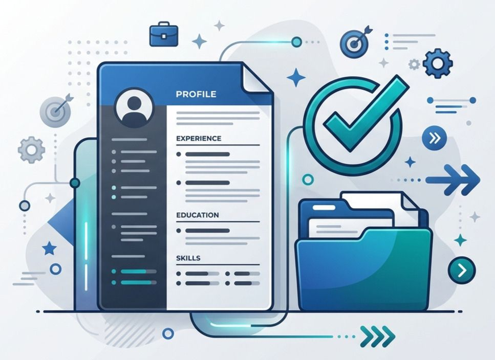

Good resume prompts tell the AI who you are, what job you want, and what you actually did, then ask it to work on one section at a time. Gemini is a strong choice because you can paste a full job description and your draft together and get focused edits. Always review the result and keep only what’s true.

If you’ve ever typed “write my resume” and got something generic, you’re not alone. This guide shows you how to use resume prompts for every section, match a job post, pass ATS filters, and keep the final draft sounding like you.

## **Why Gemini Works Best for Resume Prompts**

A resume needs two things from an AI tool: it must read a long job post and rewrite your words without drifting from them. Gemini handles both well, because you can paste the job description, your old resume, and your instructions in one message.

We also keep a tested set of [Gemini prompts](https://hostletprompt.online/best-prompts-for-gemini) for resume writing, so you don’t have to start from scratch. If you prefer another tool, the same prompts also work in [ChatGPT.](https://hostletprompt.online/best-prompts-for-chatgpt)

## **How to Write Each Resume Section With AI**

### **Resume prompts for the summary and bullet points**

Give the AI facts, not just a job title. Start with your summary, then move to bullets.

#### **Example Prompt**

Act as a professional resume writer. Write a 3-sentence resume summary for a \[job title] with \[X] years of experience in \[field]. My strongest skills are \[skill 1, skill 2, skill 3]. My best result was \[real achievement]. Use plain language, avoid buzzwords, and don't invent any facts.

Tip: Run it twice and mix the best lines from both answers.

#### **Example Prompt**

Rewrite these job duties as 3 resume bullet points. Start each with a strong action verb, show what I did and the result, and keep each under 20 words. Duties: \[paste your duties]. Don't add numbers I haven't given you.

**Tip:** Do one job at a time so the answers stay specific.

## **Tailoring steps and keyword matching**

One resume for every job rarely works. Tailoring takes about ten minutes once you have a routine:

1. Copy the full job description.

2. Ask the AI to pull out the top skills, tools, and phrases.

3. Compare that list with your resume.

4. Add missing keywords only where you have real experience.

5. Move your most relevant bullets higher up.

#### **Example Prompt**

Here is a job description: \[paste]. Here is my resume: \[paste]. List the 10 most important skills and keywords in the job description. Show which ones my resume already covers and which are missing. Only suggest adding a missing keyword if my experience supports it.

Tip: Use the exact wording from the job post, such as “project scheduling” instead of “planning,” when it’s true for you.

## **ATS-friendly resume guide**

An ATS (applicant tracking system) is software many companies use to store and search resumes. It reads text best when the file is simple.

**To keep your resume ATS-friendly:**

\* Use standard headings like Summary, Experience, Education, and Skills.

\* Stick to one column, with no tables, text boxes, or images.

\* Use a common font such as Arial or Calibri.

\* Spell out terms once, for example, “search engine optimization (SEO)”.

\* Follow the job post’s file type, usually PDF or DOCX.

Formatting matters, but so does language. A plain resume that uses the employer’s own words usually reads better to both software and people.

## **Achievements when you have no numbers**

Not every job gives you metrics, and that’s fine. You can show impact in other ways: scope, frequency, quality, speed, or who you served.

Ask yourself: What got easier because of me? Who relied on my work? What did I do that nobody asked me to?

#### **Example Prompt**

I don't have numbers for my work as \[job title]. Ask me 6 questions about my scope, tools, team size, frequency of tasks, and feedback I received. After I answer, turn my answers into 4 achievement bullets without inventing any statistics.

**Tip:** Answer honestly, even with rough estimates, and mark them as “about” or “around.”

## **Action verb list by skill type**

Weak verbs like “helped” or “worked on” hide your role. Pick verbs that match the skill:

\* Leadership: led, coordinated, mentored, supervised

\* Communication: presented, wrote, negotiated, explained.

\* Technical: built, configured, tested, automated.

\* Analysis: reviewed, compared, tracked, forecasted

\* Creative: designed, drafted, produced, launched.

\* Support: resolved, trained, guided, answered.

Don’t repeat the same verb more than twice on a page.

## **Employment gap example**

A gap isn’t a failure, and a short honest line is enough. Say what you did, then move on.

#### **Example Prompt**

Write one resume line to explain an employment gap from \[month/year] to \[month/year]. The reason was \[caregiving/health/relocation/study]. During that time, I \[courses, freelance work, volunteering]. Keep it honest, neutral, and under 25 words.

**Tip:** Place the line in your Experience section, not hidden at the bottom.

Sample output: 2022 to 2023: Career break for family caregiving. Completed an online project management course and volunteered as an event coordinator.

#### **Text-only examples, no visual layout**

Before and after samples show the change clearly. You can read these without any design.

**Before:** Responsible for social media.

**After:** Planned and posted three Instagram updates a week for a local café, which helped grow its follower base.

A finished entry should look like this:

Sara Khan | Lahore | sara@email.com

SUMMARY

Marketing assistant with two years of experience in social media and email campaigns.

EXPERIENCE

Marketing Assistant, Bright Café, 2023 to 2025

\- Planned weekly social posts and replied to customer messages.

\- Built a monthly email newsletter using Mailchimp.

EDUCATION

BBA Marketing, 2022

## **Ready-to-use resume templates**

Here’s a plain-text skeleton you can paste into a Word or Google Docs file and fill in:

\[Full Name] | \[City] | \[Email] | \[Phone] | \[LinkedIn]

SUMMARY

\[2 to 3 sentences]

SKILLS

\[Skill], \[Skill], \[Skill], \[Tool], \[Tool]

EXPERIENCE

\[Job Title], \[Company], \[Start to End]

\- \[Action verb + task + result]

\- \[Action verb + task + result]

EDUCATION

\[Degree], \[School], \[Year]

**Tip:** Ask the AI to fill it with your details, but keep the headings unchanged.

## **Layout basics (margins, spacing, file name)**

Keep the design boring, because clear beats clever:

\* Margins: 0.5 to 1 inch on all sides.

\* Font size: 10 to 12 pt for body text, slightly larger for your name.

\* Spacing: single line spacing with a clear gap between sections.

\* Length: one page for most early-career roles, two if you need them.

\* File name: FirstName-LastName-Resume.pdf, not “final_v3_new.pdf”.

Copy-paste prompt library

Here are two more prompts for sections people often skip.

#### **Example Prompt**

Turn this list of skills into a clean resume skills section grouped under Technical, Tools, and Soft Skills. Remove duplicates and anything not relevant to a \[job title] role. Skills: \[paste].

Tip: Keep only skills you can talk about in an interview.

#### **Example Prompt**

Write a one-line description for this project for my resume: \[project name, what I did, tools used, result]. Start with an action verb and keep it under 25 words.

**Tip:** Projects are great for students and career changers.

If you want to build your own, the[ free prompt generator](https://hostletprompt.online/free-prompt-generator) can turn a rough idea into a structured prompt.

## **Prompts for students, career changers, gaps**

Different situations need different focus. Tell the AI which one you’re in.

#### **Example Prompt**

I'm a \[student/career changer / returning after a gap] applying for \[target role]. I have no direct experience, but I have: \[courses, projects, volunteering, past jobs]. Rewrite these into a resume that highlights transferable skills first. Suggest section order and write the summary.

Tip: Students should lead with Education and Projects. Career changers should lead with a skills-based summary.

## **Privacy when using AI tools**

Your resume has personal data, so share only what the AI needs. Leave out your home address, ID numbers, date of birth, and references’ private details. Use placeholders like \[Phone] while drafting, and add the real details in your own document at the end. Also check your tool’s settings for chat history and data use before pasting anything sensitive.

### **Editing AI output to sound like you**

AI drafts can feel polished but flat. Fix that by reading each line out loud. If you’d never say it, change it.

#### **Example Prompt**

Here is my draft resume and a short sample of how I normally write: \[paste both]. Rewrite the summary and bullets in a similar natural tone. Keep every fact the same and avoid fancy words.

Tip: Delete any bullet that sounds impressive but isn’t something you could explain in an interview.

## **Final proofreading and fact-check**

Before sending, run through this list:

1. Check every date, job title, and company name.

2. Confirm every number is yours. Never keep statistics the AI added without a source.

3. Match your tailored keywords against the job post once more.

4. Check spelling, tense, and consistent formatting.

5. Ask a friend to read it.

#### **Example Prompt**

Review this resume as a hiring manager for \[job title]. List any unclear lines, repeated words, missing keywords, and claims that need proof. Don't rewrite anything; just give me a numbered list of issues.

Tip: Fix the issues yourself so the final voice stays yours.

## **FAQ**

### **Which AI is best for resume prompts?**

We recommend Gemini because it works well with long job descriptions and detailed edits, and it has a ready set of resume prompts on our [Gemini page](https://hostletprompt.online/best-prompts-for-gemini). Other tools like [Claude ](https://hostletprompt.online/best-prompts-for-claudeai)can work too.

### Can AI write my whole resume?

It can draft one, but you should supply the facts and review every line. A resume built from your real experience is stronger and safer.

### **How many resume prompts should I use?**

Use one prompt per section. Smaller requests give better answers than one giant message.

### **Will an ATS reject an AI-written resume?**

An ATS reads structure and keywords, not who wrote the text. A simple layout with relevant wording matters far more.

## **Conclusion**

Strong resume prompts give the AI real facts, a clear target job, and one task at a time. Use Gemini to draft, tailor, and review, then edit until it sounds like you. Your next step: pick one job post, run the keyword-matching prompt, and update your summary today.
