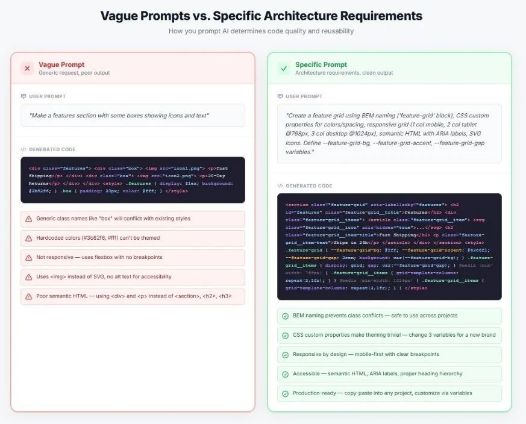

*By the HostLet Prompt team | Reading time: about 10 minutes*

AI can write code in seconds. But the code is only as good as the prompt you give it. A vague request gives you weak, buggy code. A clear request gives you code you can use.

In this guide, you will get the 10 coding prompts that web developers need most: HTML and CSS websites, responsive design, online stores, portfolios, JavaScript fixes, dashboards, mobile apps, speed, blogs and SEO. For each one you will see a ready prompt, a weak version, and what to check in the result. You will also get a model comparison for Claude, ChatGPT and Gemini, tips for agent tools like Claude Code, Cursor and Copilot, and a simple workflow for beginners. The words are easy, so you can follow along even if English is not your first language.

**What does "tested" mean here?** Every prompt uses the same test routine: run the code, check it against a short list, and fix what fails. You will find that routine in the sections below, so you can test each prompt yourself in about five minutes.

## **1. Quick Answer: What Is a Good Coding Prompt?**

**A good coding prompt is a clear instruction that tells the AI what to build, which language to use, what the input and output are, and what rules to follow.**

Think of it like giving work to a new developer. If you say "make a website," they will guess. If you give details, they will deliver what you need.

A strong coding prompt has six parts:

1. **Role:** Who the AI should act as (for example, a senior front-end developer).
2. **Task:** What you want, in one clear sentence.
3. **Context:** Your language, framework, version and project details.
4. **Input and output:** What goes in and what should come out.
5. **Rules:** Style, limits, libraries to use or avoid.
6. **Format:** How you want the answer (code only, code plus explanation, steps).

Writing all six parts every time can feel slow. If you want a shortcut, you can[ create a structured prompt in seconds](https://hostletprompt.online/free-prompt-generator) and paste it into your favorite AI tool.

## **2. Weak vs Strong Prompt: A Live Test**

Let us test the same request written two ways. This is Prompt 1 from our list.

**Weak prompt:**

Make a website for my coffee shop.

The AI does not know your colors, pages, language or layout. You will likely get a basic page that looks like every other template, with no mobile design and no clear sections.

**Strong prompt:**

Act as a senior front-end developer.

Build a one-page website for a coffee shop using plain HTML and CSS (no frameworks).

Sections: header with menu, hero with a button, 3 menu cards, about, contact form, footer.

Rules:

\- Mobile-first and fully responsive

\- Warm brown and cream colors, clean modern fonts

\- Use semantic tags (header, main, section, footer)

\- Add short comments in the code

Output: two code blocks (index.html, style.css) and a 3-line note on how to run it.

**How the two results usually differ:**

**What you check**

**Weak prompt**

**Strong prompt**

Works on first run

Sometimes

Much more likely

Looks good on mobile

Not guaranteed

Requested, so included

Clean, readable code

Mixed in one block

Split into clear files

Has the sections you need

Random

Exactly what you listed

Time spent fixing

High

Low

*Results change with each model and version, but the pattern is steady: more clear detail in means better code out.*

If you build websites often, these[ ready-to-use prompts for building websites](https://hostletprompt.online/best-prompts-for-webdevelpment) already follow the strong format.

## **3. The Top 10 Prompts (Copy, Fill, Use)**

Replace anything in \[square brackets] with your own details. After each prompt, run the test routine: **run it, check the list, fix one thing at a time.** If a blank is hard to fill, a[ free tool that fills in the prompt details for you](https://hostletprompt.online/free-prompt-generator) can help.

### **1. AI Prompt for HTML CSS Website Development**

Use this for any simple site: business page, landing page or small project. Plain HTML and CSS are fast, light and easy to host.

Act as a senior front-end developer.

Build a \[type of site] using HTML and CSS only.

Pages/sections: \[list them].

Style: \[colors, fonts, mood]. Mobile-first and responsive.

Use semantic HTML, clean class names and short comments.

Output: separate files with names, plus how to run them.

**Check:** Does it open without errors? Does the menu work on a phone screen? Are the tags semantic (header, main, footer)?

### **2. AI Prompt to Convert Design into Responsive HTML CSS**

Use this when you have a design from Figma or a screenshot. Attach the image, then paste the prompt.

I attached a design image. Convert it into responsive HTML and CSS.

Match the layout, spacing, colors and fonts as closely as possible.

Breakpoints: 360px, 768px, 1200px.

Use CSS Grid or Flexbox. No frameworks.

If something in the design is unclear, list your assumptions first.

**Check:** Place the result next to the design. Compare spacing, font sizes and colors. Then resize the browser to each breakpoint.

### **3. AI Prompt for E-Commerce Website Development**

Use this for an online store. Be clear about products, cart and checkout, because this is where most weak prompts fail.

Act as a full-stack developer.

Build a simple online store using \[stack, e.g. HTML, CSS, JavaScript and a Node.js backend].

Features: product grid, product page, add-to-cart, cart page, checkout form.

Store products in \[JSON file/database].

Rules: validate all form fields, never trust prices sent from the browser, and keep the code in clear folders.

Explain the folder structure first, then give the code.

**Check:** Can you add and remove items? Does the total update? Try changing the price in the browser: the server must ignore it.

### **4. AI Prompt for Portfolio Website Design**

Use this for designers, developers or freelancers who need a personal site that stands out.

Design and code a portfolio website for a \[profession] named \[name].

Sections: hero with a short intro, 6 project cards with image, title and link, skills, about, contact.

Style: \[minimal/dark/colorful], smooth hover effects, fast loading.

Use HTML, CSS and a little JavaScript. Fully responsive.

Write short, friendly placeholder text I can replace.

**Check:** Is the first screen clear in 5 seconds? Do the project cards link to the right pages? Is the contact form working or clearly marked as a placeholder?

### **5. AI Prompt to Fix JavaScript Errors**

This is the most-used debug prompt. Always give the full error message, the code and what you expected.

My JavaScript code gives this error: \[paste the full error from the console].

Here is the code: \[paste code].

Expected result: \[describe].

Explain the cause in simple words, then show the fixed code.

Tell me what to check to be sure it is really fixed.

**Weak version:** "My JS is not working, fix it." The AI has to guess, and it often changes code that was fine.

**Check:** Refresh the page and open the browser console. The error should be gone and no new one should appear.

### **6. AI Prompt for SaaS Dashboard Development**

Use this for admin panels, analytics screens and software tools. Dashboards need clear data, so tell the AI what numbers matter.

Act as a senior front-end developer.

Build a SaaS dashboard using \[React/Vue/HTML and JavaScript] and \[Tailwind/CSS].

Layout: left sidebar menu, top bar with search and profile, 4 stat cards, 1 line chart, 1 data table with sorting.

Use realistic fake data (JSON) for \[type of product].

Rules: clean spacing, light and dark mode, keyboard-friendly, mobile menu that collapses.

Split the code into components and explain the folder structure.

**Check:** Does the table sort? Does the sidebar collapse on mobile? Does dark mode keep text easy to read?

### **7. AI Prompt for AI Mobile App Development**

Use this to plan or start a mobile app, including apps that use AI features such as chat or image tools.

I want to build a mobile app for \[purpose] using \[React Native/Flutter].

First, give me a simple plan: screens, features and data needed.

Then write the code for the first two screens: \[screen 1] and \[screen 2].

Rules: simple navigation, clean code, handle loading and error states.

If the app uses an AI API, keep the API key on a server, never inside the app.

**Check:** Does each screen work on a small phone? Is any secret key visible in the code? Do loading and error messages appear?

### **8. AI Prompt for Website Speed Optimization**

Use this when your site feels slow. Share the real numbers, so the AI can fix real problems.

My website is slow. PageSpeed score: \[number]. Main problems: \[e.g. large images, render-blocking CSS, slow LCP].

Here is my HTML/CSS/JS: \[paste code].

Give me a prioritized list of fixes, from biggest impact to smallest.

For each fix, show the exact code change and explain why it helps.

Do not remove any features.

**Check:** Run PageSpeed Insights before and after. Write down both scores, so you know what really helped.

For more layouts and page types that follow this same strong format, browse these[ prompts made for site builders](https://hostletprompt.online/best-prompts-for-webdevelpment).

### **9. AI Prompt for Blog Website Development**

Use this for a personal blog, news site or content site that must be simple to update and good for readers.

Build a blog website using \[HTML/CSS/JS, WordPress theme, or Next.js].

Pages: home with latest posts, single post page, category page, about, contact.

Post layout: title, date, author, reading time, table of contents, related posts.

Rules: easy-to-read fonts, 700px content width, fast loading, mobile-friendly, clean URLs.

Add a simple way to add new posts, and explain it step by step.

**Check:** Is the text comfortable to read on a phone? Can you add a new post without touching the layout code?

### **10. AI Prompt for SEO Meta Tags and Schema Markup**

Use this to help search engines understand your pages. Good meta tags and schema can improve how your page looks in results.

Write SEO meta tags and JSON-LD schema for this page.

Page topic: \[topic]. Main keyword: \[keyword]. Page type: \[article/product/FAQ/local business].

Give me: a title under 60 characters, a meta description under 160 characters, Open Graph tags, and valid JSON-LD for \[Article/Product/FAQPage].

Use only facts I gave you. Do not invent reviews, ratings or prices.

**Check:** Paste the schema into Google's Rich Results Test and fix any warning. Make sure every fact in it is true for your page.

## **4. Same Prompt, Three Models: Claude vs ChatGPT vs Gemini**

If you paste the same prompt into Claude, ChatGPT and Gemini, the answers can look different. Models change often, so treat this as a general guide. The best way to choose is to test your own prompt in each tool.

**Prompt**

**What to score**

**Try first**

1. HTML CSS website

Clean files, mobile layout, semantic tags

Any of the three

2. Design to responsive HTML

Match to the design, breakpoints

Test all three, since image reading differs

3. E-commerce website

Cart logic, validation, folder structure

Claude or ChatGPT, then compare

4. Portfolio design

Visual style, clear sections

ChatGPT or Gemini, then compare

5. Fix JavaScript errors

Correct cause, small safe fix

Claude or ChatGPT

6. SaaS dashboard

Components, data table, dark mode

Claude or ChatGPT

7. Mobile app

Clear plan, working first screens

ChatGPT or Gemini

8. Speed optimization

Real fixes ranked by impact

Any, but check with PageSpeed

9. Blog website

Readable layout, easy post flow

Any of the three

10. SEO meta and schema

Valid JSON-LD, honest facts

Any, then validate in Google's tool

**General style differences:**

* **Claude** often gives careful, detailed code and clear explanations, which suits reviews, fixes and bigger builds.
* **ChatGPT** is flexible and quick, which suits fast snippets, learning and many languages.
* **Gemini** is known for large context, which helps when you paste many files or long pages.

**How to run a fair test (5 minutes):**

1. Pick one prompt, for example Prompt 5.
2. Paste the exact same text into all three tools.
3. Score each answer from 1 to 5: does it run, is it correct, is it easy to read, does it follow your rules.
4. Keep the winner for that type of task.

## **5. Agent Prompts: Claude Code, Cursor and Copilot**

Agent tools can read your project, edit many files and run commands. That is powerful, but a bad prompt can change many files at once. So think about *scope* and *safety*. You can adapt the ideas in this[ website coding prompt collection](https://hostletprompt.online/best-prompts-for-webdevelpment) for your agent too.

**Rules for good agent prompts:**

* **Name the goal and the files.** Say which folder to work in.
* **Ask for a plan first.** Let the agent explain before it edits.
* **Set limits.** Say what it must not touch.
* **Ask it to run tests** and report the result.
* **Work in small steps.** One feature per request.

**Claude Code (terminal agent) using Prompt 8, speed optimization:**

Goal: improve the page speed of the homepage.

Work only in /public and /src/components.

First, read the code and give me a short plan. Do not edit yet.

After I approve: compress and resize images, add lazy loading, remove unused CSS.

Run the build, then show a summary of every file you changed.

Do not install new packages without asking.

**Cursor (inside the editor) using Prompt 5, fix JavaScript errors:**

This function throws "Cannot read properties of undefined" when the cart is empty.

Fix it in this file only. Keep the function name and exports the same.

Add a small test for the empty-cart case. Explain the fix in 3 lines.

**GitHub Copilot Chat using Prompt 10, SEO meta tags:**

/explain this page's head section, then rewrite the title and meta description for the keyword "\[keyword]" within 60 and 160 characters.

**Tip:** For Copilot inline suggestions, write a clear comment above the code, like "// validate email and return true or false." A clear comment works like a mini prompt.

## **6. Beginner Workflow: Plan, Build, Test**

If you are new, do not ask for the whole project at once. Follow three simple steps.

### **Step 1: Plan**

Before any code, write what your project does, who uses it and the main features. Then ask for a short plan. If this feels hard,[ turn a rough idea into a clear prompt](https://hostletprompt.online/free-prompt-generator) and use that as your starting point.

I want to build \[project from the top 10 list]. I am a beginner and I use \[language].

Give me a simple step-by-step plan with small tasks.

Do not write code yet.

### **Step 2: Build**

Build one small piece at a time. Start with Prompt 1 or 4 for the page, then add features. After each piece, run it. If it works, move on. If not, use Prompt 5 with the exact error message.

### **Step 3: Test**

Test on a phone-size screen and a desktop screen. Try to break it yourself: type empty values, very long text and strange characters. Then run Prompt 8 to check speed and Prompt 10 to set up your SEO tags before you share the site.

**Remember:** you are the driver. The AI is your helper. Read every answer, run every piece of code, and ask "why" when you do not understand.

## **7. Common Mistakes and a Verification Checklist**

### **Mistakes to avoid**

1. **Being too vague.** "Fix my code" gives poor results. Share the error, the code and the goal.
2. **Asking for too much at once.** Big requests create big mistakes. Break the work into steps.
3. **Not naming the tools or versions.** Code for one version can fail in another.
4. **Copying without reading.** Always read and run the code before you use it.
5. **Skipping mobile.** Many visitors use phones, so always ask for responsive design.
6. **Pasting secrets.** Never share API keys, passwords or private customer data in a prompt.
7. **Trusting the first answer.** Ask follow-ups like "What could go wrong here?"

A good habit is to save your best prompts in one place. A[ quick prompt-writing helper](https://hostletprompt.online/free-prompt-generator) makes it easy to rebuild them when your project changes.

### **Verification checklist (use before you publish AI code)**

* I ran the code and it works with normal input.
* I tested empty, wrong and extreme input.
* I checked the page at phone, tablet and desktop sizes.
* I understand every part of the code, or I asked the AI to explain it.
* Libraries used are real, maintained and needed. (AI sometimes invents packages.)
* No secrets or keys are written in the code.
* Forms validate user input.
* I checked speed and SEO tags with free tools.

## **8. FAQ: Coding Prompts**

### **What is the best AI prompt for coding?**

The best prompt has clear details: language, task, input, output, rules and format. There is no single magic prompt, but the six-part formula in this guide works for almost every task.

### **How do I write a good prompt for coding?**

Start with a role, state one clear task, add your language and framework, describe the input and output, set rules, and say how you want the answer. Then test the result and improve the prompt.

### **Which AI is best for coding: Claude, ChatGPT or Gemini?**

All three are strong. Each has different strengths, and they change with updates. Run the same prompt in each one and choose based on your own results.

### **Can AI build a full website?**

It can build many parts of a website, and agent tools can build small projects. But you still need to review, test and secure the code. Think of AI as a fast assistant, not a replacement for understanding.

### **Which prompt should I start with as a beginner?**

Start with Prompt 1 (HTML and CSS website) or Prompt 4 (portfolio). They are simple and show results fast. Then learn Prompt 5 to fix your own errors.

### **How long should a coding prompt be?**

Long enough to be clear, short enough to stay focused. Most good prompts are 5 to 10 lines. Add more only when the task needs it.

### **Is it safe to paste my code into AI tools?**

Be careful. Never paste passwords, API keys, customer data or private company code unless your tool and your company policy allow it.

### **What should I do when the AI gives wrong code?**

Share the exact error and the code, say what you expected, and ask for an explanation plus a fix. If it keeps failing, simplify the task or start a fresh chat. For web projects, you can also try these[ ideas for building web pages with AI](https://hostletprompt.online/best-prompts-for-webdevelpment) to get a better starting point.

### **Do I need to pay for a tool to write better prompts?**

No. Good prompts come from clear thinking, and many helpers are free.

## **Final Thoughts**

Better prompts mean better code, fewer bugs and more time saved. Start with the six-part formula, use the 10 prompts above, always test what the AI gives you, and improve step by step.

At HostLet Prompt, our goal is simple: help everyone use AI with confidence, without hard words or complicated steps. If you want to save time, try our[ free AI prompt maker](https://hostletprompt.online/free-prompt-generator) for your next task.

Building a website right now? Explore more[ web design and coding prompts](https://hostletprompt.online/best-prompts-for-webdevelpment) and start faster. Bookmark this guide, save your favorite prompts, and happy coding!
