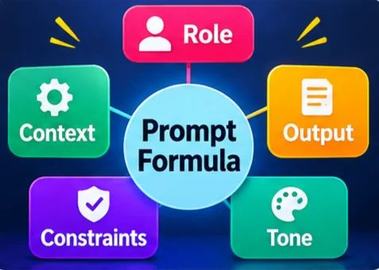
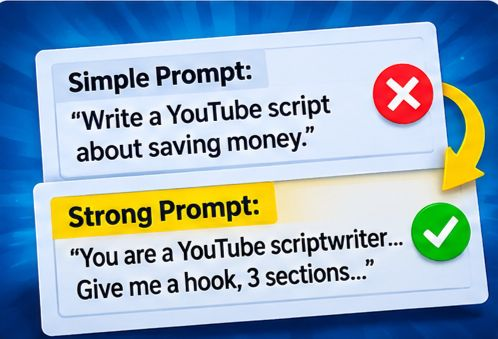

**SEO Title (under 60 characters):** Video Prompts: Tested Prompts for Viral YouTube Ideas and Scripts **Meta Description (under 155 characters):** Copy 19 tested video prompts for ChatGPT and Claude. Get viral YouTube ideas, strong hooks, and human-sounding scripts, with real output examples. **Suggested URL:** /video-prompts-youtube-ideas-scripts **Main Keyword:** video prompts **Related Keywords:** ChatGPT prompts for YouTube, YouTube script prompts, viral video ideas prompt, AI prompt for YouTube scripts, YouTube hook prompts

## **Introduction**

Let me clear one thing first. In this article, "video prompts" means the instructions you type into[ ChatGPT](https://hostletprompt.online/best-prompts-for-chatgpt/) or[ Claude](https://hostletprompt.online/best-prompts-for-claudeai/) to get YouTube video ideas and full scripts. It does not mean prompts for AI video tools that make clips.

Most creators type something like "Write a YouTube script about fitness" and get a flat, boring script. I ran the same topic through a simple prompt and through a structured prompt. The difference was big. The simple prompt gave me a script that sounded like a school essay. The structured prompt gave me a clear hook, short sections, and lines I could actually say out loud.

\[Add your real result here. Example: "The simple prompt gave me 4 usable lines out of 40. The structured prompt gave me 28."]

By the end of this article, you will have:

* 19 copy-and-paste prompts, each with a sample output and a one-line reason it works
* A formula you can use to write your own prompts
* A full workflow from idea to upload
* A list of common mistakes, and how to fix each one

Let's start with why simple prompts fail.

## **Why a Generic Prompt Fails**

Here is the prompt most people use:

Write a YouTube script about saving money.

And here is a short part of what you get back:

"Hello everyone! Welcome back to my channel. In today's video, we are going to talk about saving money. Saving money is very important in today's world. There are many ways to save money. Let's dive in!"

Why is this bad?

1. **The opening is weak.** "Hello everyone" and "in today's video" give the viewer no reason to stay.
2. **It says nothing new.** "Saving money is very important" is something every viewer already knows.
3. **It has no voice.** It could be from any channel on any topic.
4. **It has no structure.** There are no story beats, no open loops, and no reason to keep watching.

The reason is simple. The AI had to guess your audience, your tone, your video length, and your goal. When the AI guesses, it picks the most average answer. And average is boring.

The fix is to stop guessing for the AI. Tell it who you are, who you are talking to, and what the output should look like. That is what the next section covers.

## **The Prompt Formula: Role, Context, Output, Constraints, Tone**

Good prompts follow the same five parts. Some well-known YouTube tools teach a similar frame, and one popular guide adds a useful tip: put real facts inside brackets, like \[TOPIC] or \[TARGET AUDIENCE], so you can reuse the prompt again and again. I use that idea too, with my own wording below.

**Part**

**What it does**

**Example**

**Role**

Tells the AI who to act as

"You are a YouTube scriptwriter who focuses on viewer retention."

**Context**

Gives the topic, audience, and goal

"Audience: beginners aged 18 to 25 who earn a small salary."

**Output**

Tells it exactly what to return

"Give me a hook, 3 sections, and a closing line."

**Constraints**

Sets rules and limits

"No filler. No phrase like 'in this video'. Max 900 words."

**Tone**

Sets the voice

"Friendly, simple, like talking to a friend."

If you do not want to fill in these five parts by hand every time, a[ free prompt generator](https://hostletprompt.online/free-prompt-generator/) can turn a simple idea into a structured prompt for you in a few seconds.

### **Weak Prompt vs Strong Prompt**

**Weak prompt**

**Strong prompt**

Example

"Write a YouTube script about saving money."

"You are a YouTube scriptwriter. Write a 7-minute script on saving money for students with a small allowance. Start with a hook about a surprising mistake. Use short sentences. No filler. Friendly tone."

Opening line

Generic greeting

Specific, curious hook

Structure

Random

Clear sections

Edit time

45 minutes

10 to 15 minutes

Sounds like you?

No

Much closer

The more you tell the AI, the less it has to guess. Always put real data in the brackets before you press enter.

## **Set Up Your Channel DNA First**

Many guides tell you to "describe your channel" in a single line. That is not enough. Instead, create a **Channel DNA** block once, and paste it at the start of every new chat.

### **Copy-and-Paste Channel DNA Template**

Channel DNA:

\- Channel name: \[NAME]

\- Niche: \[NICHE]

\- Viewer: \[AGE, COUNTRY, LEVEL: beginner/intermediate]

\- Viewer's biggest problem: \[PROBLEM]

\- My tone: \[FUNNY / CALM / DIRECT / STORYTELLER]

\- Words I use often: \[LIST 5 WORDS]

\- Words I never use: \[LIST 5 WORDS]

\- Video length: \[MINUTES]

\- Sample of my writing (200 words):

"\[PASTE HERE]"

Learn my style from this block. Use it for every answer in this chat.

### **Why You Should Paste a 200-Word Sample**

A description like "friendly and funny" means different things to different people. A real sample shows the AI your sentence length, your jokes, and your word choice. It is the fastest way to stop the script from sounding like a robot. If you have no script yet, paste a transcript of your best-performing video.

## **Prompts for Viral Video Ideas**

Good ideas come first. A perfect script on a weak idea will not get views. The prompts below help you find stronger ideas.

### **Prompt 1: The Viral Ideas Prompt (My Main Idea Prompt)**

You are a YouTube Growth Strategist and Viral Content Expert.

Objective: Generate viral YouTube video ideas for the topic: \[TOPIC/NICHE].

Requirements

\- Analyze audience interest, trends, emotions, curiosity, and shareability.

\- Create 20 unique video ideas.

\- For each idea provide:

  1. Video Title

  2. Hook/Angle

  3. Why It Can Go Viral

  4. Target Audience

  5. Virality Score (1-10)

\- Include a mix of educational, entertainment, storytelling, challenge, comparison, and trend-based ideas.

\- Prioritize high CTR, watch time, engagement, and shareability.

\- Avoid generic, outdated, or duplicate ideas.

\- Tailor all ideas to the specified niche and current audience behavior.

Output Format

Present results in a table ranked from highest to lowest Virality Score.

**Sample output (niche: personal finance for students), shortened to 3 rows:**

**Rank**

**Title**

**Hook/Angle**

**Why It Can Go Viral**

**Audience**

**Score**

1

I Lived on $5 a Day for 7 Days

A challenge with real receipts

Challenge + curiosity + easy to share

Students

9

2

5 Money Habits Rich Kids Learn at 10

Compare two money mindsets

Strong emotion, comment-friendly

Ages 16-24

8

3

Student Budget App Test: Which Is Best?

Head-to-head comparison

Search demand + clear answer

Students

7

**Why it works:** It asks for a score and a ranking, so the AI has to judge its own ideas instead of listing random ones.

**Note:** The "Virality Score" is the AI's opinion, not a fact. Treat it as a rough filter, then check the idea yourself (see "How to Check Any Idea" below).

### **Prompt 2: Trend-Based Idea Prompt**

You are a YouTube strategist. My niche is \[NICHE].

List 10 video ideas that connect a current news event or popular trend to my niche.

For each idea give: the trend, the video title, and why my viewer cares.

Only use trends from the last 30 days. If you are not sure a trend is current, say so.

**Sample output (short):**

* Trend: A big phone launch. Title: "Is the New Phone Worth It for Students? A Money Test." Why they care: Students are deciding what to buy.

**Why it works:** Asking the AI to say when it is "not sure" cuts down fake trends. Always confirm trends on Google Trends before filming.

### **Prompt 3: Contrarian Idea Prompt**

My niche is \[NICHE]. List 5 common beliefs my viewers have.

For each one, write a video idea that respectfully challenges the belief.

Give a title and a one-line reason the belief might be wrong.

**Sample output (short):**

* Belief: "You must cut all small spending to save money." Title: "Stop Skipping Coffee. Do This Instead." Reason: Small cuts rarely change your life. Big choices do.

**Why it works:** People click when a video disagrees with what they believe. It creates curiosity right away.

### **Prompt 4: Series Idea Prompt**

Turn this successful video into a 5-part series: \[VIDEO TITLE].

For each part give: a title, a one-line summary, and a cliffhanger that makes the viewer want the next part.

**Sample output (short):**

* Part 1: "I Saved $100 in 7 Days." Cliffhanger: "But the third day nearly ruined everything."

**Why it works:** Series videos bring viewers back, and viewers who return help your channel grow.

### **Prompt 5: Audience Questions Prompt**

My viewers are \[AUDIENCE]. List 15 questions they would type into Google or YouTube about \[TOPIC].

Group them by how urgent the problem feels: high, medium, low.

**Why it works:** Questions people actually type often become strong video ideas.

### **How to Check Any Idea (Do This Before You Film)**

AI can invent trends that do not exist. Use this quick check:

1. **YouTube search bar.** Type your keyword and see what auto-suggestions appear. Real suggestions mean real demand.
2. **Google Trends.** Check if interest is rising, steady, or falling.
3. **Search results.** If the top results are old or weak, you have room to do better.
4. **Gut check.** Would you click this title? If not, drop it.

## **Title and Thumbnail Prompts**

Your title and thumbnail decide if anyone clicks. Keep this part short, but do not skip it.

### **Prompt 6: Title Prompt**

Write 10 YouTube titles for a video about \[TOPIC] for \[AUDIENCE].

Rules: Under 60 characters. Include one clear benefit or one strong curiosity gap.

No clickbait that the video cannot prove. Mix these styles: number, question, how-to, mistake, challenge.

**Sample output (short):**

* "7 Money Mistakes Students Make Every Month" (number)
* "Why Your Budget Always Fails" (question)

**Why it works:** The "cannot prove" rule keeps titles honest, which helps viewers stay and keeps trust.

### **Prompt 7: Thumbnail Text Prompt**

Give me 8 thumbnail text ideas for the video titled "\[TITLE]".

Each idea must be 1 to 4 words. It must add something the title does not already say.

**Sample output (short):** "STOP THIS", "$5 ONLY", "NOBODY TELLS YOU".

**Why it works:** Thumbnail text that repeats the title wastes space. Short extra text adds a second reason to click.

## **Hook Prompts (The Most Important Part)**

The hook is the first 5 to 30 seconds of your video. If viewers leave here, nothing else matters. Aim to give a reason to stay in the first 5 seconds, and to prove that reason by the 30-second mark.

### **Banned Phrases (Add These to Every Hook Prompt)**

Tell the AI never to use:

* "Hey guys" or "Hello everyone"
* "Welcome back to my channel"
* "In this video, I will..."
* "Today we are going to talk about..."
* "Before we start, don't forget to subscribe"
* "Let's dive in"

These openers tell the viewer nothing. Save any greeting for later in the video.

### **Prompt 8: The Curiosity Hook**

Write 5 YouTube hooks for a video on \[TOPIC]. Each hook must be under 40 words.

Start with a surprising fact or a question the viewer cannot ignore.

Do not use: "Hey guys", "in this video", "welcome back", "let's dive in".

**Sample output:** "Most students lose $40 a month and have no idea where it goes. I tracked every cent for 30 days. The answer was not coffee."

**Why it works:** It opens a question (where did the money go?) that the viewer wants answered.

### **Prompt 9: The Story Hook**

Write a 5-sentence story hook for a video on \[TOPIC].

Start in the middle of a moment, not at the beginning. Use one real-feeling detail.

End on a line that makes the viewer ask "what happened next?"

**Sample output:** "I was standing at the shop counter when my card was declined. Behind me, five people were waiting. I had $3 in my bank. And rent was due the next day."

**Why it works:** It drops the viewer into a tense moment, so they feel something before they think.

### **Prompt 10: The Result-First Hook**

Write 3 hooks that show the final result first, then say how I got there.

Topic: \[TOPIC]. Use a real number. Keep each under 35 words.

**Sample output:** "I saved $1,200 in 3 months on a small salary. No second job. I used one simple rule."

**Why it works:** Viewers see the prize first, so they stay to learn the method.

### **Prompt 11: The Problem Hook**

Write 3 hooks that describe a problem my viewer feels every day: \[PROBLEM].

Make them feel understood in the first sentence. Then promise one clear fix.

**Sample output:** "You get paid on the 1st, and by the 10th you are broke again. It is not your salary. It is one hidden habit."

**Why it works:** When someone feels understood, they trust you faster.

### **Prompt 12: The Hook Tightener**

Here is my hook: "\[PASTE HOOK]".

Rewrite it in 5 different ways, each under 25 words.

Remove any filler. Keep the strongest idea. Tell me which one you would pick and why.

**Why it works:** Short hooks win. This prompt trims the fat and gives you choices to compare.

**The 5 to 30 Second Rule:** In the first 5 seconds, show the problem or the prize. By second 30, show the viewer you can deliver. After that, move to the main content.

## **Script Structure: Hook, Context, Body, Payoff, CTA**

A good script follows a simple path. One creator framework splits videos into four acts, and I like that idea. Here is my own version in five plain steps:

1. **Hook.** Give a reason to stay (5 to 30 seconds).
2. **Context.** Say why this matters to the viewer now (20 to 40 seconds).
3. **Body.** Deliver the main points, one at a time.
4. **Payoff.** Give the answer you promised in the hook.
5. **CTA (Call to Action).** Ask for one clear action, such as watching the next video.

### **Why You Should Not Ask for the Whole Script at Once**

When you request a full script in one go, the AI rushes. Sections get thin, ideas repeat, and the ending feels weak. Instead, build it step by step:

1. Ask for an outline.
2. Edit the outline.
3. Ask for one section at a time.
4. Join and polish.

This gives you more control and better quality in every part.

### **Prompt 13: The Master Script Prompt (My Main Script Prompt)**

AI Prompt for YouTube Video Scripts

Role

You are an expert YouTube Scriptwriter and Audience Retention Strategist.

Task

Create a high-retention YouTube video script on \[TOPIC] for \[TARGET AUDIENCE].

Objectives

\- Grab attention immediately.

\- Deliver accurate, valuable, and engaging content.

\- Maximize watch time and retention.

\- Encourage audience interaction and action.

Instructions

1. Open with a strong hook that creates curiosity, urgency, or a clear benefit.

2. Briefly explain why the topic matters.

3. Organize the script into clear sections with smooth transitions.

4. Use relevant stories, examples, data, insights, or case studies.

5. Keep the tone conversational and engaging.

6. Eliminate filler and repetition.

7. Answer likely audience questions naturally.

8. Add engagement prompts where appropriate.

9. End with a memorable conclusion and strong CTA.

10. Match the complexity and language to the audience.

Requirements

\- Prioritize clarity, accuracy, and value.

\- Maintain strong pacing throughout.

\- Focus on actionable takeaways.

\- Ensure every section keeps viewers interested.

Output Format

\- 5 Video Title Ideas

\- Hook

\- Introduction

\- Main Script (Sectioned)

\- Engagement Prompts

\- Key Takeaways

\- Conclusion

\- Call to Action

\- 3 Thumbnail Text Ideas

Inputs

\- Topic: \[TOPIC]

\- Target Audience: \[TARGET AUDIENCE]

\- Video Length: \[SHORT / MEDIUM / LONG]

\- Tone: \[TONE]

\- Goal: \[EDUCATE / INFORM / ENTERTAIN / PERSUADE]

**Sample output (Topic: saving money; Audience: students; Length: Medium; Tone: friendly; Goal: educate), shortened:**

**Title ideas:** 1) "Why You Are Always Broke (It's Not Your Salary)" 2) "The 50-30-20 Rule for Students" ...

**Hook:** "You get your allowance on Monday. By Friday, it's gone. And you cannot say where it went. Here's the fix, and it takes five minutes."

**Introduction:** "Money habits made in your early twenties tend to stay for life. So let's build a good one now."

**Main Script, Section 1:** "Step one is to track. Not forever. Just 7 days. Write down every payment, even a tea."

**CTA:** "If this helped, watch my next video on building a first emergency fund."

**Why it works:** The fixed output format forces the AI to give you every part of the script, so nothing is missing.

**Tip:** Do not copy this word for word on every video. Fill in the brackets with real details, and add your Channel DNA block before it.

### **Prompt 14: The Outline Prompt**

Using my Channel DNA, create an outline for a \[LENGTH]-minute video on \[TOPIC].

Use five parts: Hook, Context, Body (3 to 5 points), Payoff, CTA.

For each part, write one sentence on what it must achieve and how long it should be.

**Why it works:** You approve the plan before any writing starts, so you avoid rewriting a whole script later.

### **Prompt 15: The Section Writer**

Write only the "Body, Point 2" section from the approved outline.

Length: about 180 words. Use one real example and one simple comparison.

Keep sentences under 15 words. End with a line that leads into Point 3.

**Why it works:** A small task gives a focused, higher-quality answer.

## **Retention: Pattern Interrupts and Open Loops**

Retention means how long people keep watching. Two simple tools help here.

* **Open loop:** You mention something now and explain it later. Example: "Later, I'll show you the one mistake that cost me $200."
* **Pattern interrupt:** A sudden change that wakes the viewer up, such as a new visual, a short question, a change in tone, or a quick story.

A good rule is to add a re-hook every 60 to 90 seconds.

### **Prompt 16: The Re-Hook Prompt**

Here is my script: \[PASTE SCRIPT].

Find every spot where a viewer might get bored (long explanation, repeated idea, slow part).

At each spot, add a re-hook of 1 to 2 sentences. Use open loops, a surprising fact, or a direct question.

Mark each re-hook in \[BRACKETS]. Do not change the rest of the script.

**Sample output:**

...so that is how a budget works. \[REHOOK: "But there's a trap hiding inside every budget, and it got me twice."] Now, let's move to the next step...

**Why it works:** It points to weak spots and fixes only those, so your own writing stays intact.

## **How to Make Your Script Sound Human**

This is where most AI scripts fail. They read well on paper but sound strange when spoken. Use these three checks.

### **1. The Read-Aloud Test**

Read the script out loud at a normal speed. If you trip, run out of breath, or feel silly, the line needs a change. Cut it, shorten it, or split it in two.

### **2. The AI Word Stop-List**

AI often repeats certain words and phrases. Add this to your prompt and also search your final script for them:

* "Delve", "unleash", "game-changer", "ultimate guide"
* "In today's fast-paced world"
* "It is important to note that"
* "Navigate the landscape"
* "Unlock the power of"
* "In conclusion" and "Let's dive in"

Replace each with plain words. Instead of "unlock the power of", say "use".

### **3. The Word Count Math**

Most people speak at about 140 to 150 words per minute on camera. Use this table:

**Video length**

**Words needed**

3 minutes

420 to 450

5 minutes

700 to 750

8 minutes

1,120 to 1,200

10 minutes

1,400 to 1,500

15 minutes

2,100 to 2,250

If you add pauses, B-roll, or jokes, aim a little lower.

### **Prompt 17: The Humanizer Prompt**

Rewrite this script so it sounds like a real person talking.

Rules:

\- Keep sentences under 15 words most of the time. Mix in a few very short ones.

\- Use contractions (it's, don't, you'll).

\- Remove these words: delve, unleash, game-changer, ultimate, "in today's fast-paced world".

\- Add 2 small personal touches or reactions, like "honestly" or "I didn't expect that".

\- Keep my meaning and facts exactly the same.

Here is my style sample: "\[PASTE 200 WORDS]". Match it.

Script: \[PASTE SCRIPT]

**Sample output:**

* Before: "It is important to note that budgeting can unlock the power of financial freedom."
* After: "Honestly, budgeting sounds boring. But it's the fastest way to feel less stressed about money."

**Why it works:** It gives the AI clear rules plus a style sample, so it edits instead of guessing.

## **The Full Workflow: From Idea to Upload**

**Step**

**What you do**

**Prompt to use**

1

Paste your Channel DNA

Template above

2

Generate 20 ideas

Prompt 1

3

Check top 3 ideas on YouTube search and Google Trends

Manual check

4

Pick one idea and write titles

Prompt 6

5

Write 5 hooks, choose the best

Prompts 8 to 12

6

Create an outline

Prompt 14

7

Write the script section by section

Prompt 15 (or Prompt 13 for a first draft)

8

Add re-hooks

Prompt 16

9

Make it sound human

Prompt 17

10

Read aloud and check word count

Manual

11

Check facts and add real examples

Manual

12

Thumbnail text, record, edit, upload

Prompt 7

## **My Test: Generic Prompt vs Structured Prompt**

I ran both types of prompts on the same topics. For each, I judged four things: hook strength, structure, sounds human, and edit time.

**Test topic 1:** "How to save money on a small salary"

**Generic prompt**

**Structured prompt (Prompt 13 + Channel DNA)**

Hook

"Hello everyone, today we talk about saving money."

"You get paid on the 1st and you're broke by the 10th. It's not your salary."

Structure

One long block

Hook, 3 sections, payoff, CTA

Sounds human (1-10)

\[add your score]

\[add your score]

Edit time

\[add your time]

\[add your time]

**Test topic 2:** \[add your topic] **Test topic 3:** \[add your topic]

\[Add screenshots of both outputs here. Showing your real results is what makes this article unique.]

## **Common Mistakes and How to Fix Them**

**Mistake**

**Why it hurts**

**Fix**

1. Asking for a full script in one go

Rushed, thin sections

Build outline first, then section by section

2. No audience details

Output is generic

Always fill \[TARGET AUDIENCE] with age, level, and problem

3. Copying AI output without editing

Sounds robotic

Run the humanizer and read aloud

4. Trusting the "Virality Score"

It is the AI's guess

Verify with YouTube search and Google Trends

5. Weak opening lines

Viewers leave in 5 seconds

Use banned-phrase list and hook prompts

6. Not checking facts

AI can invent numbers

Verify every stat and source yourself

7. Same prompt for every video

Videos feel the same

Update brackets and Channel DNA each time

## **Short-Form (Shorts and TikTok) Is Different**

Shorts need a faster pace. You have no time for context or a slow build.

**Long-form**

**Shorts / TikTok**

Length

5 to 20 minutes

Under 60 seconds

Hook time

5 to 30 seconds

1 to 3 seconds

Words

700 to 2,500

80 to 150

Structure

5 parts

Hook, one point, payoff

Re-hooks

Every 60 to 90 seconds

Every 10 to 15 seconds

CTA

Detailed

One short line, or none

### **Prompt 18: The Shorts Script Prompt**

Write a 45-second YouTube Shorts script about \[TOPIC] for \[AUDIENCE].

Max 120 words. First line must be a hook under 10 words.

One idea only. End with a line that makes people replay or comment.

**Sample output:** "Your salary isn't the problem. \[Pause] Here's the 10-second trick that fixed my budget. Rule one: pay yourself first. Move 20% the day you get paid. Then spend what's left. That's it. Try it for one month and tell me what happened."

**Why it works:** One idea and a tight word limit keep it fast.

### **Prompt 19: Turn a Long Video Into 3 Shorts**

Here is my long video script: \[PASTE]. Find the 3 most interesting moments.

For each, write a 40-second Shorts script with a new hook.

Do not just copy the original lines.

**Why it works:** You get extra content from work you already did.

## **FAQ**

**1. Does YouTube penalize AI-written scripts?** YouTube has not said it punishes a script only because AI helped write it. What matters is whether viewers enjoy the video. Low-effort, repeated, or mass-produced content can hurt a channel. Edit every script, add your own examples, and be the voice behind it. Check YouTube's current policy for the latest rules.

**2. How many words do I need for a 10-minute video?** About 1,400 to 1,500 words. See the word count table above.

**3. Is free ChatGPT enough?** Yes, for most of these prompts. Paid plans may give longer answers and better memory, but a clear prompt matters more than the plan. You can also browse more[ best prompts for ChatGPT](https://hostletprompt.online/best-prompts-for-chatgpt/) to build your own prompt collection.

**4. Which is better, ChatGPT or Claude?** Both work. Try the same prompt in each and keep the one that matches your voice better. If you want a starting point for Claude, see these[ best prompts for Claude](https://hostletprompt.online/best-prompts-for-claudeai/).

**5. Can I use the same prompt for every video?** Yes, as a base. Change the brackets and the Channel DNA details each time.

**6. How do I stop the script from sounding robotic?** Paste a 200-word sample of your own writing, use the stop-list, and read it out loud.

**7. How long should a hook be?** Between 5 and 30 seconds. Shorter is usually better.

**8. Should I trust the facts the AI gives me?** No. Always check numbers, names, and dates from a reliable source before you film.

## **Conclusion and Next Step**

Good video prompts do three things: they give the AI a clear role, they share real details about your audience and channel, and they ask for a clear format. Use the ideas prompt to find topics, the hook prompts to start strong, and the script prompt to build the video step by step. Then edit with your own voice.

**Your next step:** Pick one video idea today. Paste your Channel DNA, run Prompt 1, then run Prompt 13 on your best idea. Save both outputs and compare them with a generic prompt. You will see the difference in minutes. If you want to build prompts for other tasks too, try our[ free prompt generator](https://hostletprompt.online/free-prompt-generator/).

If this guide helped, share it with a creator friend who is stuck on scripts.
